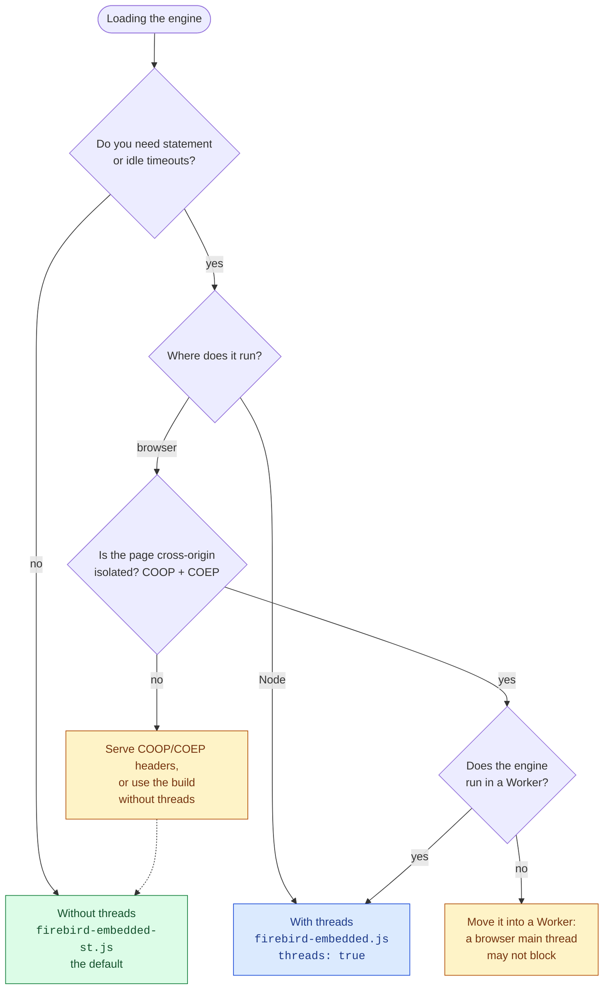
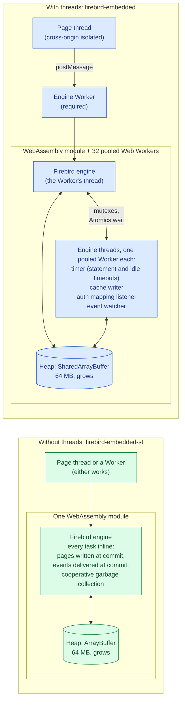
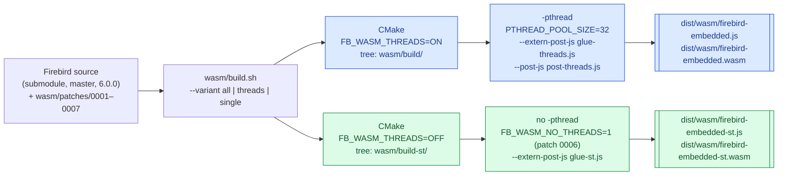

# The two engine builds: with threads and without

`firebird-wasm` ships Firebird 6 compiled to WebAssembly twice. The two builds
run the same engine from the same source, and differ only in whether it has
threads:

| | Without threads (default) | With threads |
|---|---|---|
| Files | `firebird-embedded-st.js` + `.wasm` | `firebird-embedded.js` + `.wasm` |
| Size, `.wasm` (gzipped) | 9.35 MB (3.05 MB) | 9.43 MB (3.07 MB) |
| Memory | a plain `ArrayBuffer` | a `SharedArrayBuffer` |
| Needs a cross-origin isolated page (COOP/COEP headers) | no | yes |
| Needs a Worker in the browser | no: it can run on the page thread | yes |
| Workers it starts | none | a pool of 32 at load |
| Start-up, Node | 0.33–0.43 s | 0.87–1.06 s |
| One-row `SELECT` of ten columns | 34–49 µs a call | 54–76 µs |
| Statement and idle timeouts | no | yes |
| Runs on GitHub Pages and other hosts that can't set headers | yes | no |

The build without threads has been the default since 0.9.0. It was not slower
in anything measured. Ask for the threaded build only when you need statement
or idle timeouts and can serve the page cross-origin isolated.

## Which one to load



In code, every loading route takes the same `threads` choice. Leave it out
for the default; pass `true` for threads:

```ts
import { wasmGlueFile, loadFirebirdWasm, cdnArtifacts } from 'firebird-wasm/browser';

// In the engine's Worker (or on the page, for the build without threads):
importScripts(`/wasm/${wasmGlueFile()}`);                         // firebird-embedded-st.js
importScripts(`/wasm/${wasmGlueFile(true)}`);                     // firebird-embedded.js
importScripts(`/wasm/${wasmGlueFile(self.crossOriginIsolated)}`); // threads where the page allows them

// Node, tests, or the engine's Worker:
await loadFirebirdWasm({ threads: true });
new DirectTransport({ threads: true });
cdnArtifacts({ threads: true });
```

The threaded build refuses to load in a page that is not cross-origin
isolated, with a message naming the other build. It used to hang there,
because its runtime could not hand shared memory to its own workers.

## How each one runs



**With threads.** Firebird starts threads and treats a failed `pthread_create`
as fatal. Emscripten runs each thread on a Web Worker, and the threads share
the module's memory, so the heap has to be a `SharedArrayBuffer`. Browsers only
hand those to cross-origin isolated pages. A thread waiting on a mutex blocks
with `Atomics.wait`, which a browser main thread may not call, so the engine
runs in a Worker. The build starts a pool of 32 Workers at load: creating one
on demand while the requesting thread blocks waiting for it is a deadlock.

**Without threads.** Traced through a database's whole life (create, DDL,
DML, transactions, events, detach), the engine started five threads, and none
of them is needed in a single process:

| Thread | In the build without threads |
|---|---|
| timer | does not start. It tells other processes that the trace storage is alive, and there are none. It also drives statement and idle timeouts, which is why those are lost. |
| auth mapping listener | does not start. It waits for other processes' cache resets; one process clears its own cache directly. |
| cache writer | does not start. Super mode already runs without one for read-only databases; pages are written when released and at commit. |
| garbage collector | not started by configuration: the bridge opens every database with `GCPolicy = cooperative`, in both builds. |
| event watcher | does not start. The event manager delivers to its own process inline, at commit, so `fb_events_poll()` right after the commit sees the event. |

All of this is one patch, `wasm/patches/0006`, under `#ifdef FB_WASM_NO_THREADS`.
The threaded build is unchanged by it.

## How they are built



```bash
source third_party/emsdk/emsdk_env.sh
bash packages/firebird-wasm/wasm/build.sh                    # both (the default)
bash packages/firebird-wasm/wasm/build.sh --variant single   # without threads only
bash packages/firebird-wasm/wasm/build.sh --variant threads  # with threads only
```

Each variant has a build tree of its own, because `-pthread` changes how every
object file is compiled. A full build takes about 40 minutes per variant; an
incremental one, a few. The build applies the patches to the submodule as it
runs: restore it afterwards with
`git -C packages/firebird-wasm/wasm/firebird-src checkout -- . && git -C packages/firebird-wasm/wasm/firebird-src clean -fdq`.

Two small scripts mark the builds apart:

- `glue-threads.js` / `glue-st.js` (`--extern-post-js`) set
  `createFirebirdModule.threads` on the factory. The loader uses that to
  refuse the threaded build where it cannot run.
- `post-threads.js` (`--post-js`, threaded only) exposes
  `Module.fbTerminateThreads`, so `disposeFirebirdWasm()` can end the worker
  pool. The pool lives inside the module's closure, out of the loader's reach.

## Letting a module go

Both builds can be disposed (since 0.9.0): `disposeFirebirdWasm(mod)`, or the
last `close()` of the databases using a module. The threaded build has more
to end: its 32 Workers, and the main thread's `Atomics.waitAsync` on its
mailbox, which held the whole module until Emscripten's `terminateRuntime`
settled it. Measured in Node over ten load/dispose cycles, memory levels off
at about 200 MB without threads and about 300 MB with them.

## Tested on both

Every suite that touches the engine runs on each build:

- `wasm-integration.test.ts` runs once per build.
- `wasm-single-thread.test.ts` checks the plain heap, a database's whole life,
  and inline events.
- `wasm-dispose.test.ts` checks disposal on each build.
- `browser-single-thread.spec.ts` serves pages without COOP/COEP headers. It
  runs the build without threads on the page thread and in a Worker, and
  checks that the threaded build is refused.
- The example apps take threads where the page allows them, so their isolated
  CI runs keep exercising the threaded build.

## See also

- [integration.md §2](./integration.md#2-the-two-hard-requirements-and-the-build-without-them):
  the headers and the Worker, for the threaded build.
- [plans/sab-free-build.md](./plans/sab-free-build.md): how the build without
  threads was planned, traced and measured.
- [api.md](./api.md): `loadFirebirdWasm`, `disposeFirebirdWasm`,
  `wasmGlueFile`, `cdnArtifacts`.
