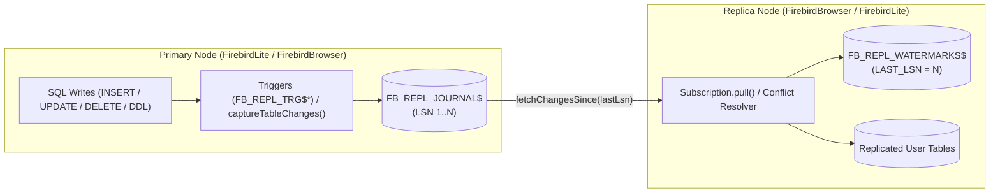
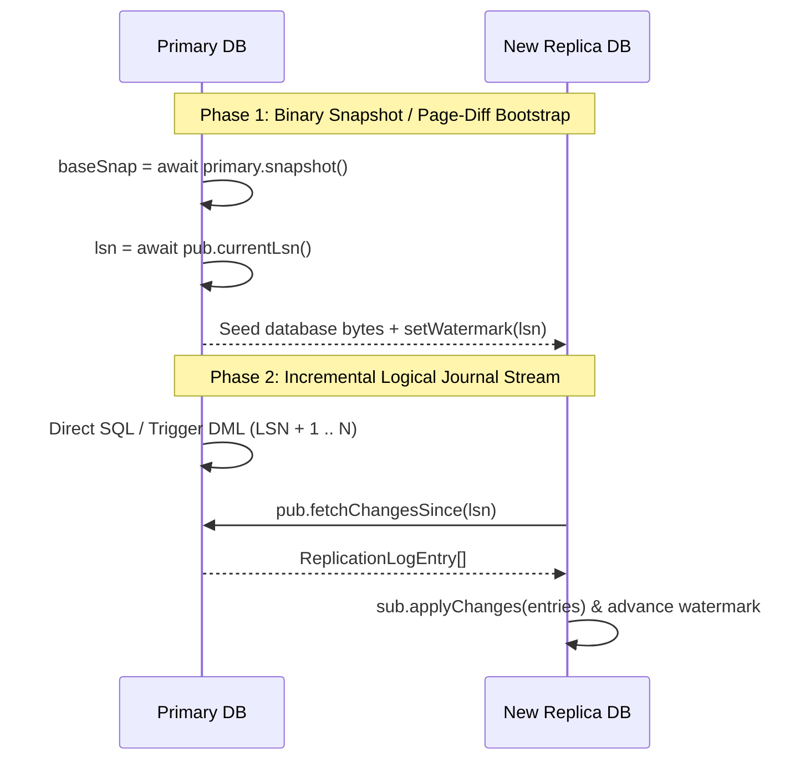

# Database Replication Guide (`firebird-wasm/replication`)

`firebird-wasm/replication` provides logical and journal-based database replication between `FirebirdLite` (Node.js / server / desktop) and `FirebirdBrowser` (WebAssembly / OPFS / IndexedDB), as well as peer-to-peer across browser tabs or edge workers.

> **Interactive Simulator & Live Demo**: Try the [Firebird WASM Replication Simulator & Live Demo](https://mariuz.github.io/electric-firebird/replication.html) (`demo/public/replication.html`) to inspect live `FB_REPL_JOURNAL$` LSN streams, trigger capture, network partitions, and 3-way conflict resolution in real time.

---

## Table of Contents

1. [Architecture Overview](#1-architecture-overview)
2. [Quick Start — Replication Setup](#2-quick-start--replication-setup)
   - [High-Level `replicateDatabases()` Setup](#21-high-level-replicatedatabases-setup)
   - [Explicit Publication & Subscription Setup](#22-explicit-publication--subscription-setup)
3. [Native Firebird SQL Trigger-Based Change Capture](#3-native-firebird-sql-trigger-based-change-capture)
   - [Automatic Trigger Installation (`installReplicationTriggers`)](#31-automatic-trigger-installation-installreplicationtriggers)
   - [Loop Prevention via `RDB$GET_CONTEXT` / `RDB$SET_CONTEXT`](#32-loop-prevention-via-rdbget_context--rdbset_context)
4. [Conflict Resolution Strategies](#4-conflict-resolution-strategies)
5. [Full Database Replication: Snapshot Bootstrap & Schema Evolution](#5-full-database-replication-snapshot-bootstrap--schema-evolution)
   - [Phase 1 — Initial Snapshot or Binary Page-Diff (`exportDiff` / `applyDiff`) Bootstrap](#51-phase-1--initial-snapshot-or-binary-page-diff-exportdiff--applydiff-bootstrap)
   - [Phase 2 — Automatic Schema Evolution (`diffSchema` + `generateMigration`)](#52-phase-2--automatic-schema-evolution-diffschema--generatemigration)
   - [Phase 3 — Journal Pruning & Watermark Management](#53-phase-3--journal-pruning--watermark-management)
6. [Replication Use Cases](#6-replication-use-cases)
7. [API Reference](#7-api-reference)

---

## 1. Architecture Overview

Replication in `firebird-wasm` is built around three core primitives stored inside standard Firebird SQL tables and sequences:

1. **Change Journal (`FB_REPL_JOURNAL$`) & Sequence (`FB_REPL_LSN_GEN$`)**:
   Every published DDL or DML mutation (`INSERT`, `UPDATE`, `DELETE`, `DDL`) is recorded with a monotonically increasing **Log Sequence Number (`LSN`)**, transaction ID (`TXID`), originating node ID (`ORIGIN`), publication name (`PUBLICATION`), primary key (`KEY_JSON`), `BEFORE_JSON` / `AFTER_JSON` row snapshots, and epoch timestamp (`TS`).
2. **Replica Watermarks (`FB_REPL_WATERMARKS$`)**:
   Each subscriber persists its last applied `LAST_LSN` watermark inside `FB_REPL_WATERMARKS$` within the same atomic replica transaction that applies the incoming changes—guaranteeing **at-least-once delivery with idempotent replay**.
3. **Echo-Loop Prevention (`ORIGIN` & `FB_REPL_ROLE`)**:
   In bidirectional (`primary <-> replica`) topologies, changes are tagged with `origin: nodeId` and applied under `RDB$SET_CONTEXT('USER_SESSION', 'FB_REPL_ROLE', 'REPLICA')` so replica replay never re-triggers local change capture.



---

## 2. Quick Start — Replication Setup

### 2.1 High-Level `replicateDatabases()` Setup

Use `replicateDatabases()` to pair two `FirebirdBrowser` or `FirebirdLite` instances in either `'one-way'` (`primary -> replica`) or `'bidirectional'` (`primary <-> replica`) mode:

```ts
import { FirebirdBrowser, replicateDatabases } from 'firebird-wasm/browser';

const primary = await FirebirdBrowser.create({ database: 'primary.fdb' });
const replica = await FirebirdBrowser.create({ database: 'replica.fdb' });

// Provision schema on both nodes
const schemaSql = `
  CREATE TABLE TODOS (
    ID INTEGER NOT NULL PRIMARY KEY,
    TITLE VARCHAR(120) NOT NULL,
    DONE SMALLINT DEFAULT 0
  )
`;
await primary.exec(schemaSql);
await replica.exec(schemaSql);

// Pair databases in bidirectional mode with 3-way field-level merge
const replicator = await replicateDatabases({
  primary,
  replica,
  tables: [{ table: 'TODOS', primaryKey: 'ID', columns: ['ID', 'TITLE', 'DONE'] }],
  direction: 'bidirectional', // 'one-way' | 'bidirectional'
  onConflict: 'merge',       // 'primary-wins' | 'replica-wins' | 'last-write-wins' | 'merge' | fn
  installTriggers: true,     // Install AFTER INSERT/UPDATE/DELETE PSQL triggers
  onConflictResolved(ctx, resolution) {
    console.log(`Conflict on ${ctx.incoming.table} resolved via ${resolution}`);
  },
});

// Mutate primary and replica independently
await primary.execute('INSERT INTO TODOS (ID, TITLE, DONE) VALUES (?, ?, ?)', [1, 'Ship WASM engine', 0]);
await replica.execute('INSERT INTO TODOS (ID, TITLE, DONE) VALUES (?, ?, ?)', [2, 'Write replication docs', 1]);

// Run a single replication cycle (or call `replicator.start()` for continuous background sync)
const stats = await replicator.sync();
console.log('Primary -> Replica:', stats.primaryToReplica);
console.log('Replica -> Primary:', stats.replicaToPrimary);
```

### 2.2 Explicit Publication & Subscription Setup

When the primary and replica live in separate processes (e.g., a Node.js `FirebirdLite` backend and a browser `FirebirdBrowser` client over HTTP/WebSocket), create the publication and subscription separately:

```ts
import { createPublication, createSubscription } from 'firebird-wasm/replication';

// 1. On the Primary (Server):
const publication = await createPublication(serverDb, {
  name: 'edge_pub',
  nodeId: 'cloud-primary-1',
  tables: [
    { table: 'PROJECTS', primaryKey: 'ID' },
    { table: 'TASKS', primaryKey: 'ID' },
  ],
  installTriggers: true,
});

// Expose an HTTP endpoint that returns `publication.fetchChangesSince(sinceLsn, { limit, excludeOrigin })`

// 2. On the Replica (Browser Client):
const subscription = await createSubscription(browserDb, {
  name: 'edge_sub_client_42',
  nodeId: 'browser-client-42',
  publication: {
    name: 'edge_pub',
    async fetchChangesSince(sinceLsn, opts) {
      const res = await fetch(
        `/api/replication/changes?sinceLsn=${sinceLsn}&limit=${opts?.limit ?? 500}&excludeOrigin=${opts?.excludeOrigin ?? ''}`,
      );
      return res.json();
    },
  },
  onConflict: 'last-write-wins',
  pollIntervalMs: 1000,
});

// Pull on demand or start background polling:
await subscription.pull();
subscription.start();
```

---

## 3. Native Firebird SQL Trigger-Based Change Capture

### 3.1 Automatic Trigger Installation (`installReplicationTriggers`)

When `installTriggers: true` is passed to `createPublication()` (or `installReplicationTriggers(db, options)` is called directly), `firebird-wasm` provisions:

1. An atomic LSN sequence: `CREATE SEQUENCE FB_REPL_LSN_GEN$`
2. The change journal table: `FB_REPL_JOURNAL$`
3. An idempotent `AFTER INSERT OR UPDATE OR DELETE POSITION 32000` PSQL trigger (`FB_REPL_TRG$<TABLE>`) on every published table, plus `POST_EVENT 'fb_repl_<publication>'` for instant event-driven wakeups.

```ts
import { installReplicationTriggers, buildReplicationTriggerDdl } from 'firebird-wasm/replication';

const triggers = await installReplicationTriggers(db, {
  publication: 'default',
  nodeId: 'primary-1',
  tables: [
    { table: 'ORDERS', primaryKey: ['ID'], columns: ['ID', 'CUSTOMER', 'TOTAL', 'STATUS'] },
  ],
});

console.log(triggers[0].triggerName); // "FB_REPL_TRG$ORDERS"
console.log(triggers[0].eventName);   // "fb_repl_default"
```

### 3.2 Loop Prevention via `RDB$GET_CONTEXT` / `RDB$SET_CONTEXT`

Every generated trigger guards execution with Firebird's session context variable `FB_REPL_ROLE`:

```sql
IF (RDB$GET_CONTEXT('USER_SESSION', 'FB_REPL_ROLE') IS DISTINCT FROM 'REPLICA') THEN
BEGIN
  -- Serialize NEW.* / OLD.* into FB_REPL_JOURNAL$ and POST_EVENT
END
```

When `subscription.pull()` or `subscription.applyChanges()` runs on a replica, it wraps the batch transaction in:

```sql
SELECT RDB$SET_CONTEXT('USER_SESSION', 'FB_REPL_ROLE', 'REPLICA') FROM RDB$DATABASE;
-- Apply incoming DDL & DML changes
SELECT RDB$SET_CONTEXT('USER_SESSION', 'FB_REPL_ROLE', 'PRIMARY') FROM RDB$DATABASE;
```

This guarantees that applying remote changes on a node that also has triggers installed never re-logs those mutations back into the local journal.

---

## 4. Conflict Resolution Strategies

When two nodes modify the same primary key concurrently before syncing, `createSubscription` / `replicateDatabases` detects the conflict by comparing `entry.before` against `localRow` (and `localEntry.timestamp`) and invokes the configured `onConflict` strategy:

| Strategy | Behavior | Best For |
|---|---|---|
| `'primary-wins'` / `'remote-wins'` | Incoming change overwrites the local row. | Read replicas, server-authoritative caches. |
| `'replica-wins'` / `'local-wins'` | Local row is preserved; conflicting remote mutation is skipped. | Local user overrides, sticky drafts. |
| `'last-write-wins'` | Compares `incoming.timestamp` vs `localEntry.timestamp` (deterministic tie-breaker on `origin` node ID). | General active-active peer sync. |
| `'merge'` | **3-way field-level merge** (`mergeReplicatedRow(before, localRow, remoteAfter)`): merges non-overlapping column edits onto the same row. | Collaborative forms, multi-column task/document editors. |
| Custom `(ctx) => ...` | Receives `{ incoming, localRow, localEntry }` and returns `'remote-wins'`, `'local-wins'`, `'merge'`, or `{ action: 'merge', row }`. | Domain-specific business rules (e.g., inventory counters, financial ledgers). |

#### Example: Custom Conflict Resolver

```ts
const sub = await createSubscription(replicaDb, {
  publication,
  onConflict: ({ incoming, localRow }) => {
    if (incoming.table === 'INVENTORY' && localRow && incoming.after && incoming.before) {
      // Additive delta merge on QTY column
      const delta = Number(incoming.after.QTY) - Number(incoming.before.QTY);
      return {
        action: 'merge',
        row: {
          ...localRow,
          ...incoming.after,
          QTY: Number(localRow.QTY) + delta,
        },
      };
    }
    return 'merge';
  },
});
```

---

## 5. Full Database Replication: Snapshot Bootstrap & Schema Evolution

For large databases or newly provisioned replicas, replaying the entire historical `FB_REPL_JOURNAL$` from `LSN = 0` is unnecessary. Combine **Incremental Binary Page Diffs (`exportDiff` / `applyDiff`)** with **Logical Journal Replay** for fast full-database replication:



### 5.1 Phase 1 — Initial Snapshot or Binary Page-Diff (`exportDiff` / `applyDiff`) Bootstrap

```ts
// 1. Capture the primary's current LSN and binary image
const currentLsn = await primaryPublication.currentLsn();
const baseImage = await primary.exportDatabase();

// 2. Hydrate the replica from the binary image and align its watermark
const replica = await FirebirdBrowser.create({
  database: 'replica.fdb',
  initialData: baseImage,
});
await replicaSubscription.setWatermark(currentLsn);

// Or, when catching up a replica between two Copy-on-Write snapshots:
const diffBytes = await primary.exportDiff(olderSnapshot);
await replica.applyDiff(diffBytes);
await replicaSubscription.setWatermark(await primaryPublication.currentLsn());
```

### 5.2 Phase 2 — Automatic Schema Evolution (`diffSchema` + `generateMigration`)

Before applying DML batches after a schema upgrade, you can either replicate DDL via `publication.recordDdl(sql)` or automatically diff and migrate the replica catalog using `diffSchema()` and `generateMigration()`:

```ts
import { diffSchema, generateMigration, migrate } from 'firebird-wasm/browser';

const schemaDiff = await diffSchema(replica, primary);
if (!schemaDiff.isEmpty) {
  const migration = generateMigration(schemaDiff, { version: Date.now(), name: 'auto_replica_sync' });
  await migrate(replica, [migration]);
}
```

### 5.3 Phase 3 — Journal Pruning & Watermark Management

Once all active subscribers have advanced past a given LSN, reclaim storage on the primary:

```ts
const minConfirmedLsn = await replicaSubscription.getWatermark();
const deletedRows = await primaryPublication.pruneJournal(minConfirmedLsn);
```

---

## 6. Replication Use Cases

| # | Use Case | Topology | Recommended Conflict Strategy |
|---|---|---|---|
| **1** | **Offline-First Field & Mobile Apps** | Bidirectional (`FirebirdBrowser` ↔ `FirebirdLite`) | `'merge'` (3-way field merge) |
| **2** | **Multi-Tab / Multi-Window Instant Sync** | Bidirectional across tabs (`BroadcastChannel` + OPFS) | `'last-write-wins'` |
| **3** | **Cloud-to-Browser Read Replicas** | One-Way (`FirebirdLite` → `FirebirdBrowser`) | `'primary-wins'` |
| **4** | **Edge / CDN Read Scaling** | One-Way Fan-Out (1 Primary → N Edge Workers) | `'primary-wins'` |
| **5** | **Collaborative Multi-User Workspaces** | Bidirectional Hub-and-Spoke | `'merge'` + custom resolvers |
| **6** | **Zero-Downtime Schema & Version Upgrades** | Shadow Replica (`diffSchema` + `replicateDatabases`) | `'primary-wins'` |
| **7** | **Continuous Backup, PITR & Audit Time-Travel** | Append-Only Journal Subscriber (`FB_REPL_JOURNAL$`) | `'primary-wins'` |
| **8** | **Hybrid RAG / Local Vector + BM25 Search Sync** | One-Way (`primary` → local `HnswIndex` / `Bm25Index`) | `'primary-wins'` |
| **9** | **Multi-Tenant Data Slicing (Partial Publications)** | Filtered Per-Tenant Publication → Client Replica | `'primary-wins'` / `'merge'` |
| **10** | **CI / Ephemeral PR Preview Databases** | Snapshot `exportDiff` + Journal Tail | `'primary-wins'` |
| **11** | **Desktop Electron / Tauri Local-to-Cloud Sync** | Bidirectional (`FirebirdLite` Desktop ↔ Cloud) | `'merge'` / `'last-write-wins'` |
| **12** | **Telemetry & IoT Edge-to-Central Consolidation** | Many-to-One (`Edge Replicas` → `Central Aggregator`) | `'replica-wins'` / append-only |

---

## 7. API Reference

| Export | Description |
|---|---|
| `replicateDatabases(options)` | High-level helper pairing `primary` and `replica` in `'one-way'` or `'bidirectional'` mode. |
| `createPublication(db, options)` | Provisions `FB_REPL_JOURNAL$` and returns a `ReplicationPublication` handle. |
| `createSubscription(db, options)` | Provisions `FB_REPL_WATERMARKS$` and returns a `ReplicationSubscription` handle. |
| `installReplicationTriggers(db, options)` | Creates `FB_REPL_LSN_GEN$` and installs `AFTER INSERT OR UPDATE OR DELETE` PSQL triggers on published tables. |
| `dropReplicationTriggers(db, options)` | Drops replication triggers for the given tables and publication. |
| `buildReplicationTriggerDdl(options)` | Pure helper returning `{ triggerName, eventName, ddl }` for a table's PSQL replication trigger. |
| `replicationTriggerName(table, pub?)` | Deterministic ≤31-char Firebird trigger name (`FB_REPL_TRG$<TABLE>`). |
| `replicationEventName(pub?)` | Deterministic ≤31-char Firebird `POST_EVENT` name (`fb_repl_<pub>`). |
| `mergeReplicatedRow(before, local, remote)` | 3-way field-level merge helper used by the `'merge'` conflict strategy. |
