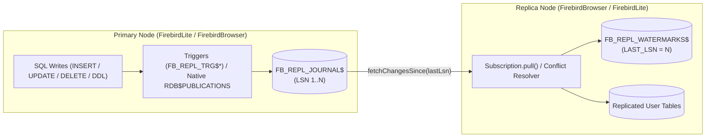
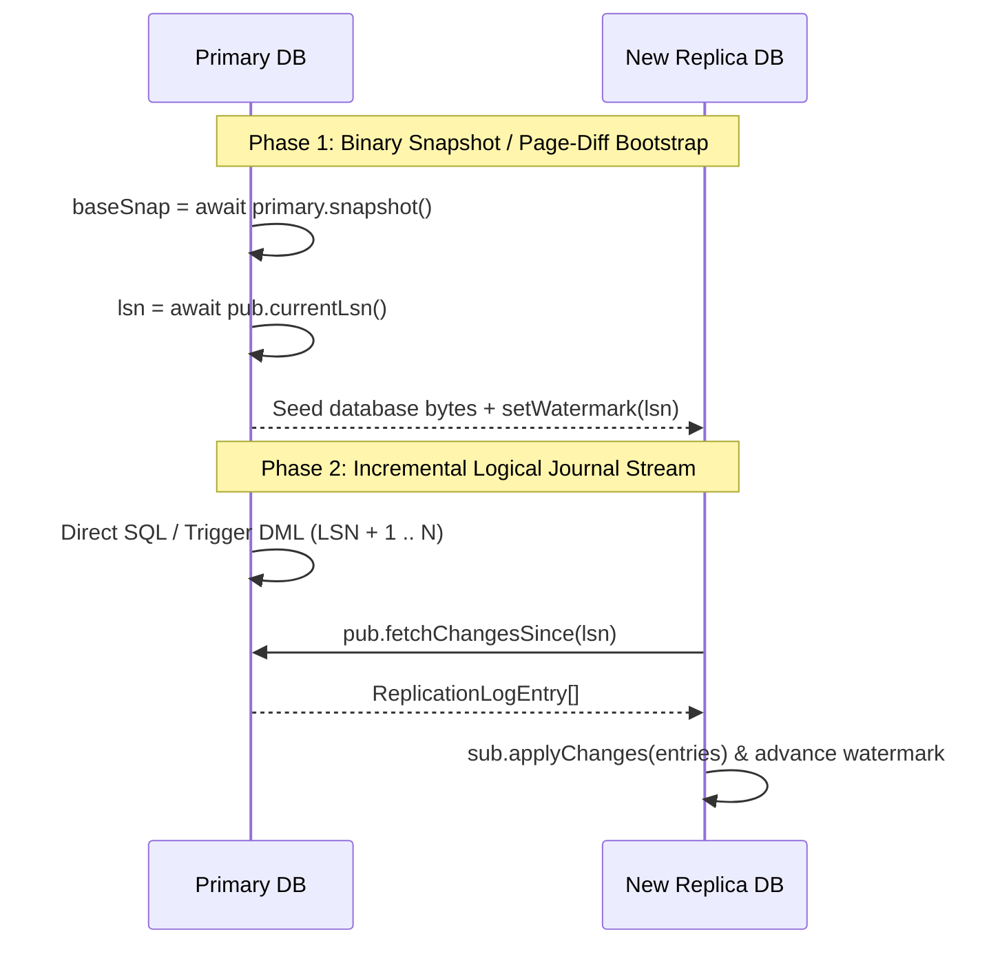

# Database Replication Guide (`firebird-wasm/replication`)

`firebird-wasm/replication` provides logical, journal-based, and native Firebird C++ engine (`"FBCHANGELOG\0"` / `IReplicator`) database replication between `FirebirdLite` (Node.js / server / desktop) and `FirebirdBrowser` (WebAssembly / OPFS / IndexedDB / Memory), as well as peer-to-peer across browser tabs, WebSockets, or multi-node clusters.

> **Interactive Simulator & Live Demo**: Try the [Firebird WASM Replication Simulator & Live Demo](https://mariuz.github.io/electric-firebird/replication.html) (`demo/public/replication.html`) to inspect live `FB_REPL_JOURNAL$` LSN streams, trigger capture, CRDT merges, multi-node mesh/hub watermarks, `FB_REPL_DLQ$` quarantine/retry, AES-256-GCM encrypted segments, and time-travel rewind in real time.

---

## Table of Contents

1. [Architecture Overview](#1-architecture-overview)
2. [Quick Start — Replication Setup](#2-quick-start--replication-setup)
   - [2.0 One-Liner `syncDatabases()` & `db.syncWith()`](#20-one-liner-syncdatabases--dbsyncwith)
   - [2.1 High-Level `replicateDatabases()` Setup](#21-high-level-replicatedatabases-setup)
   - [2.2 Explicit Publication & Subscription Setup](#22-explicit-publication--subscription-setup)
3. [SQL Trigger-Based Change Capture](#3-sql-trigger-based-change-capture)
   - [3.1 Automatic Trigger Installation (`installReplicationTriggers`)](#31-automatic-trigger-installation-installreplicationtriggers)
   - [3.2 Echo-Loop Prevention via `RDB$GET_CONTEXT` / `RDB$SET_CONTEXT`](#32-echo-loop-prevention-via-rdbget_context--rdbset_context)
4. [Conflict Resolution & CRDTs](#4-conflict-resolution--crdts)
   - [4.1 Built-In & Custom Conflict Strategies](#41-built-in--custom-conflict-strategies)
   - [4.2 Hybrid Logical Clocks (`createHlc`) & Per-Column CRDTs (`createCrdtConflictResolver`)](#42-hybrid-logical-clocks-createhlc--per-column-crdts-createcrdtconflictresolver)
5. [Full Database Replication Lifecycle](#5-full-database-replication-lifecycle)
   - [5.1 Snapshot & Binary Page-Diff Bootstrap (`bootstrapReplica` & `needsBootstrap`)](#51-snapshot--binary-page-diff-bootstrap-bootstrapreplica--needsbootstrap)
   - [5.2 Whole-Database Publication (`publishAllTables`) & Catalog Sync (`syncCatalog`)](#52-whole-database-publication-publishalltables--catalog-sync-synccatalog)
   - [5.3 Multi-Tenant Row/Column Filtering & Topological Foreign-Key Replay](#53-multi-tenant-rowcolumn-filtering--topological-foreign-key-replay)
   - [5.4 Replication Slots (`FB_REPL_SLOTS$`) & Safe Auto-Pruning (`pruneAcked`)](#54-replication-slots-fb_repl_slots--safe-auto-pruning-pruneacked)
   - [5.5 Network Transports (HTTP/SSE, WebSocket & `BroadcastChannel`)](#55-network-transports-httpsse-websocket--broadcastchannel)
   - [5.6 Binary (`0x52444246`) & AES-256-GCM Encrypted (`0x53444246`) Journal Segments](#56-binary-0x52444246--aes-256-gcm-encrypted-0x53444246-journal-segments)
   - [5.7 Automatic Failover & Replica-to-Primary Promotion (`promoteReplica`)](#57-automatic-failover--replica-to-primary-promotion-promotereplica)
   - [5.8 Time-Travel Querying (`asOfLsn`) & Point-in-Time Rollback (`rewindToLsn`)](#58-time-travel-querying-asoflsn--point-in-time-rollback-rewindtolsn)
6. [Multi-Node Topologies, Resilience & Operations](#6-multi-node-topologies-resilience--operations)
   - [6.1 Multi-Node Mesh & Hub-and-Spoke Coordinator (`createReplicationMesh` / `createReplicationHub`)](#61-multi-node-mesh--hub-and-spoke-coordinator-createreplicationmesh--createreplicationhub)
   - [6.2 Dead-Letter Queue (`FB_REPL_DLQ$`) & Quarantine / Retry Policy](#62-dead-letter-queue-fb_repl_dlq--quarantine--retry-policy)
   - [6.3 Data Masking, PII Redaction & Row Transformation (`transformRow`)](#63-data-masking-pii-redaction--row-transformation-transformrow)
   - [6.4 PITR Journal Archives (`exportJournalArchive` / `applyJournalArchive`)](#64-pitr-journal-archives-exportjournalarchive--applyjournalarchive)
   - [6.5 Journal Compaction & Automated Retention Policies (`compactJournal` / `applyRetentionPolicy`)](#65-journal-compaction--automated-retention-policies-compactjournal--applyretentionpolicy)
   - [6.6 Structured Telemetry & Prometheus / OpenTelemetry Export (`createReplicationMetricsCollector`)](#66-structured-telemetry--prometheus--opentelemetry-export-createreplicationmetricscollector)
   - [6.7 Schema-Aware Replication & DDL Compatibility Guard](#67-schema-aware-replication--ddl-compatibility-guard)
7. [Native Firebird Engine Replication (`RDB$PUBLICATIONS`, `replication.conf`, `"FBCHANGELOG\0"` & `IReplicator`)](#7-native-firebird-engine-replication-rdbpublications-replicationconf-fbchangelog0--ireplicator)
   - [7.1 `RDB$PUBLICATIONS`, `replication.conf` & `IReplicator`](#71-rdbpublications-replicationconf--ireplicator)
   - [7.2 `"FBCHANGELOG\0"` Binary Opcode Decoder, JRD Record/Sequence Extractor & Continuous Changelog Poller](#72-fbchangelog0-binary-opcode-decoder-jrd-recordsequence-extractor--continuous-changelog-poller)
8. [Replication Use Cases](#8-replication-use-cases)
9. [API Reference](#9-api-reference)

---

## 1. Architecture Overview

Logical journal replication in `firebird-wasm` is built around standard Firebird SQL tables, sequences, and session context variables (alongside optional native C++ JRD engine changelog integration in [§7](#7-native-firebird-engine-replication-rdbpublications-replicationconf-fbchangelog0--ireplicator)):

1. **Change Journal (`FB_REPL_JOURNAL$`) & Sequence (`FB_REPL_LSN_GEN$`)**:
   Every published DDL or DML mutation (`INSERT`, `UPDATE`, `DELETE`, `DDL`) is recorded with a monotonically increasing **Log Sequence Number (`LSN`)**, transaction ID (`TXID`), originating node ID (`ORIGIN`), publication name (`PUBLICATION`), primary key (`KEY_JSON`), `BEFORE_JSON` / `AFTER_JSON` row snapshots, and epoch/HLC timestamp (`TS`, `HLC`).
2. **Replica Watermarks (`FB_REPL_WATERMARKS$`) & Slots (`FB_REPL_SLOTS$`)**:
   Each subscriber persists its last applied `LAST_LSN` watermark inside `FB_REPL_WATERMARKS$` within the same atomic replica transaction that applies incoming changes—guaranteeing **at-least-once delivery with idempotent replay**—while `FB_REPL_SLOTS$` tracks acknowledged flush positions on the primary for safe auto-pruning.
3. **Echo-Loop Prevention (`ORIGIN` & `FB_REPL_ROLE`)**:
   In bidirectional (`primary <-> replica`) and mesh topologies, changes carry `origin: nodeId` and are applied under `RDB$SET_CONTEXT('USER_SESSION', 'FB_REPL_ROLE', 'REPLICA')` so replica replay never re-triggers local change capture.



---

## 2. Quick Start — Replication Setup

### 2.0 One-Liner `syncDatabases()` & `db.syncWith()`

For common peer, BroadcastChannel, WebSocket, or HTTP sync setups, `syncDatabases(source, target, options?)` (or the instance method `db.syncWith(peerOrUrlOrChannel, options?)`) automatically introspects user tables (`tables: '*'`), syncs missing schema DDL + sequence watermarks, bootstraps initial rows via batched `IBatch` `UPDATE OR INSERT`, installs `FB_REPL_TRG$*` triggers, and returns an `AsyncDisposable` `SyncHandle`:

```ts
import { openDatabase, syncDatabases } from 'firebird-wasm/browser';

await using primary = await openDatabase('memory://primary');
await using replica = await openDatabase('memory://replica');

await primary.execute('CREATE TABLE TASKS (ID INT NOT NULL PRIMARY KEY, TITLE VARCHAR(120))');
await primary.execute('INSERT INTO TASKS VALUES (?, ?)', [1, 'Seeded before sync']);

// 1-liner bidirectional sync (auto-bootstraps schema + row #1 onto replica):
await using sync = await syncDatabases(primary, replica); // or: await primary.syncWith(replica)

await replica.execute('INSERT INTO TASKS VALUES (?, ?)', [2, 'Added on replica']);
await sync.syncOnce();
console.log(await sync.stats());

// Also accepts an HTTP endpoint URL, WebSocket, or BroadcastChannel name:
// const remoteSync = await replica.syncWith('https://api.example.com/replication');
// const tabSync = await replica.syncWith('broadcast://my-app-tabs');
```

### 2.1 High-Level `replicateDatabases()` Setup

Use `replicateDatabases()` to pair two `FirebirdBrowser` or `FirebirdLite` instances in either `'one-way'` (`primary -> replica`) or `'bidirectional'` (`primary <-> replica`) mode:

```ts
import { FirebirdBrowser } from 'firebird-wasm/browser';
import { replicateDatabases } from 'firebird-wasm/replication';

const primary = new FirebirdBrowser('memory://primary');
const replica = new FirebirdBrowser('memory://replica');

// Provision schema on both nodes
const schemaSql = `
  CREATE TABLE TODOS (
    ID INTEGER NOT NULL PRIMARY KEY,
    TITLE VARCHAR(120) NOT NULL,
    DONE SMALLINT DEFAULT 0
  )
`;
await primary.exec(schemaSql);
await replica.exec(schemaSql);

// Pair databases in bidirectional mode with 3-way field-level merge
const replicator = await replicateDatabases({
  primary,
  replica,
  tables: [{ table: 'TODOS', primaryKey: 'ID', columns: ['ID', 'TITLE', 'DONE'] }],
  direction: 'bidirectional', // 'one-way' | 'bidirectional'
  onConflict: 'merge',       // 'primary-wins' | 'replica-wins' | 'last-write-wins' | 'merge' | fn
  installTriggers: true,     // Install AFTER INSERT/UPDATE/DELETE PSQL triggers
  onConflictResolved(ctx, resolution) {
    console.log(`Conflict on ${ctx.incoming.table} resolved via`, resolution);
  },
});

// Mutate primary and replica independently
await primary.exec('INSERT INTO TODOS (ID, TITLE, DONE) VALUES (?, ?, ?)', [1, 'Ship WASM engine', 0]);
await replica.exec('INSERT INTO TODOS (ID, TITLE, DONE) VALUES (?, ?, ?)', [2, 'Write replication docs', 1]);

// Run a single replication cycle (or call `replicator.start()` for continuous background sync)
const stats = await replicator.sync();
console.log('Primary -> Replica:', stats.primaryToReplica);
console.log('Replica -> Primary:', stats.replicaToPrimary);
```

### 2.2 Explicit Publication & Subscription Setup

When the primary and replica live in separate processes (e.g., a Node.js `FirebirdLite` backend and a browser `FirebirdBrowser` client over HTTP/WebSocket), create the publication and subscription separately:

```ts
import { createPublication, createSubscription } from 'firebird-wasm/replication';

// 1. On the Primary (Server):
const publication = await createPublication(serverDb, {
  name: 'edge_pub',
  nodeId: 'cloud-primary-1',
  tables: [
    { table: 'PROJECTS', primaryKey: 'ID' },
    { table: 'TASKS', primaryKey: 'ID' },
  ],
  installTriggers: true,
});

// Expose an HTTP endpoint (see §5.5 `createHttpReplicationHandler` for a ready-made handler)

// 2. On the Replica (Browser Client):
const subscription = await createSubscription(browserDb, {
  name: 'edge_sub_client_42',
  nodeId: 'browser-client-42',
  publication: {
    name: 'edge_pub',
    async fetchChangesSince(sinceLsn, opts) {
      const res = await fetch(
        `/api/replication/changes?sinceLsn=${sinceLsn}&limit=${opts?.limit ?? 500}&excludeOrigin=${opts?.excludeOrigin ?? ''}`,
      );
      return res.json();
    },
  },
  onConflict: 'last-write-wins',
  pollIntervalMs: 1000,
});

// Pull on demand or start background polling:
await subscription.pull();
subscription.start();
```

---

## 3. SQL Trigger-Based Change Capture

### 3.1 Automatic Trigger Installation (`installReplicationTriggers`)

When `installTriggers: true` is passed to `createPublication()` (or `installReplicationTriggers(db, options)` is called directly), `firebird-wasm` provisions:

1. An atomic LSN sequence: `CREATE SEQUENCE FB_REPL_LSN_GEN$`
2. The change journal table: `FB_REPL_JOURNAL$`
3. An idempotent `AFTER INSERT OR UPDATE OR DELETE POSITION 32000` PSQL trigger (`FB_REPL_TRG$<TABLE>`) on every published table, plus `POST_EVENT 'fb_repl_<publication>'` for instant event-driven wakeups.

```ts
import { installReplicationTriggers } from 'firebird-wasm/replication';

const triggers = await installReplicationTriggers(db, {
  publication: 'default',
  nodeId: 'primary-1',
  tables: [
    { table: 'ORDERS', primaryKey: ['ID'], columns: ['ID', 'CUSTOMER', 'TOTAL', 'STATUS'] },
  ],
});

console.log(triggers[0].triggerName); // "FB_REPL_TRG$ORDERS"
console.log(triggers[0].eventName);   // "fb_repl_default"
```

### 3.2 Echo-Loop Prevention via `RDB$GET_CONTEXT` / `RDB$SET_CONTEXT`

Every generated trigger guards execution with Firebird's session context variable `FB_REPL_ROLE`:

```sql
IF (RDB$GET_CONTEXT('USER_SESSION', 'FB_REPL_ROLE') IS DISTINCT FROM 'REPLICA') THEN
BEGIN
  -- Serialize NEW.* / OLD.* into FB_REPL_JOURNAL$ and POST_EVENT
END
```

When `subscription.pull()` or `subscription.applyChanges()` runs on a replica, it wraps the batch transaction in:

```sql
SELECT RDB$SET_CONTEXT('USER_SESSION', 'FB_REPL_ROLE', 'REPLICA') FROM RDB$DATABASE;
-- Apply incoming DDL & DML changes
SELECT RDB$SET_CONTEXT('USER_SESSION', 'FB_REPL_ROLE', 'PRIMARY') FROM RDB$DATABASE;
```

This guarantees that applying remote changes on a node with triggers installed never re-logs those mutations back into the local journal.

---

## 4. Conflict Resolution & CRDTs

### 4.1 Built-In & Custom Conflict Strategies

When two nodes modify the same primary key concurrently before syncing, `createSubscription` / `replicateDatabases` detects the conflict by comparing `entry.before` against `localRow` (and `localEntry.timestamp`) and invokes the configured `onConflict` strategy:

| Strategy | Behavior | Best For |
|---|---|---|
| `'primary-wins'` / `'remote-wins'` | Incoming change overwrites the local row. | Read replicas, server-authoritative caches. |
| `'replica-wins'` / `'local-wins'` | Local row is preserved; conflicting remote mutation is skipped. | Local user overrides, sticky drafts. |
| `'last-write-wins'` | Compares `incoming.timestamp` / `hlc` vs `localEntry` (deterministic tie-breaker on `origin` node ID). | General active-active peer sync. |
| `'merge'` | **3-way field-level merge** (`mergeReplicatedRow(before, localRow, remoteAfter)`): merges non-overlapping column edits onto the same row. | Collaborative forms, multi-column task/document editors. |
| Custom `(ctx) => ...` | Receives `{ incoming, localRow, localEntry }` and returns `'remote-wins'`, `'local-wins'`, `'merge'`, or `{ action: 'merge', row }`. | Domain-specific business rules (inventory counters, ledgers). |

```ts
const sub = await createSubscription(replicaDb, {
  publication,
  onConflict: ({ incoming, localRow }) => {
    if (incoming.table === 'INVENTORY' && localRow && incoming.after && incoming.before) {
      const delta = Number(incoming.after.QTY) - Number(incoming.before.QTY);
      return {
        action: 'merge',
        row: { ...localRow, ...incoming.after, QTY: Number(localRow.QTY) + delta },
      };
    }
    return 'merge';
  },
});
```

### 4.2 Hybrid Logical Clocks (`createHlc`) & Per-Column CRDTs (`createCrdtConflictResolver`)

Use `createHlc()` for skew-tolerant causal ordering (`<wallMs>:<counter>:<nodeId>`) and `createCrdtConflictResolver()` to combine per-column CRDT strategies (`'pn-counter'`, `'set-union'`, `'g-set'`, `'max'`, `'min'`, `'lww'`):

```ts
import { replicateDatabases, createCrdtConflictResolver } from 'firebird-wasm/replication';

const replicator = await replicateDatabases({
  primary: nodeA,
  replica: nodeB,
  tables: [{ table: 'PRODUCTS', primaryKey: 'ID' }],
  direction: 'bidirectional',
  onConflict: createCrdtConflictResolver({
    columns: {
      STOCK: 'pn-counter', // additive delta merge: base + localDelta + remoteDelta
      TAGS: 'set-union',   // 2P/OR-Set union with removal tracking
      HIGH_BID: 'max',     // join-semilattice max
      TITLE: 'lww',        // HLC-ordered Last-Write-Wins
    },
  }),
});
```

---

## 5. Full Database Replication Lifecycle

For large databases or newly provisioned replicas, combine **Initial Snapshot / Binary Page-Diff Bootstrap** with **Incremental Journal Replay**:



### 5.1 Snapshot & Binary Page-Diff Bootstrap (`bootstrapReplica` & `needsBootstrap`)

Use `bootstrapReplica()` (or enable `autoBootstrap: true` on `createSubscription()` / `replicateDatabases()`) to seed a new replica or catch up a replica whose watermark has fallen behind a pruned journal (`watermark < minRetainedLsn`):

```ts
import { bootstrapReplica, needsBootstrap } from 'firebird-wasm/replication';

const check = await needsBootstrap(primaryPublication, replicaSubscription);
if (check.needed) {
  const boot = await bootstrapReplica({
    targetDb: replica,
    publication: primaryPublication,
    subscription: replicaSubscription,
    mode: 'logical', // or 'page-diff' for binary FBDF\x01 page diff
  });
  console.log(`Bootstrapped ${boot.rowsCopied} rows at LSN ${boot.watermarkLsn}`);
}
```

### 5.2 Whole-Database Publication (`publishAllTables`) & Catalog Sync (`syncCatalog`)

Publish every user table (`tables: '*'`) and keep replica schemas + Firebird sequence/generator watermarks (`RDB$GENERATORS`) synchronized via `syncCatalog()`:

```ts
import { publishAllTables, syncCatalog } from 'firebird-wasm/replication';

const pub = await publishAllTables(primary, {
  name: 'full_pub',
  excludeTables: ['AUDIT_SCRATCH'],
  installTriggers: true,
});

const catResult = await syncCatalog({
  sourceDb: primary,
  targetDb: replica,
  excludeTables: ['AUDIT_SCRATCH'],
});
console.log(catResult.discoveredTables, catResult.sequencesSynced);
```

### 5.3 Multi-Tenant Row/Column Filtering & Topological Foreign-Key Replay

Slice publications per tenant with `where` predicates and `columns` / `excludeColumns` projections, and declare foreign-key `references` so multi-table transactions (`txid`) replay parents before children on `INSERT`/`UPDATE` and children before parents on `DELETE`:

```ts
const tenantPub = await createPublication(primary, {
  name: 'tenant_acme_pub',
  tables: [
    {
      table: 'USERS',
      primaryKey: 'ID',
      excludeColumns: ['PASSWORD_HASH'],
      where: "TENANT_ID = 'acme'",
    },
    {
      table: 'ORDERS',
      primaryKey: 'ID',
      where: "TENANT_ID = 'acme'",
      references: ['USERS'],
    },
  ],
});
```

### 5.4 Replication Slots (`FB_REPL_SLOTS$`) & Safe Auto-Pruning (`pruneAcked`)

Each subscriber registers a slot in `FB_REPL_SLOTS$` (`slotName`, `nodeId`, `confirmedFlushLsn`, `lastSeenAt`, `ttlMs`). Calling `publication.pruneAcked()` expires stale slots past their TTL and safely deletes only journal entries `<= MIN(confirmedFlushLsn)` across all active subscribers:

```ts
const pruneResult = await primaryPublication.pruneAcked();
// { expiredSlots: [], activeSlotCount: 2, safeLsn: 42, prunedEntries: 42 }
```

### 5.5 Network Transports (HTTP/SSE, WebSocket, `BroadcastChannel` & Gzipped `"FBCHANGELOG\0"` Streaming)

Connect `FirebirdLite` (server) and `FirebirdBrowser` (WASM) across HTTP/SSE, duplex WebSockets, or browser tabs:

```ts
import {
  createHttpReplicationHandler,
  createHttpReplicationClient,
  createBroadcastChannelTransport,
  createWebSocketReplicationPeer,
  createSubscription,
} from 'firebird-wasm/replication';

// 1. Server HTTP/SSE endpoint (Web Fetch API Request -> Response)
const handler = createHttpReplicationHandler({
  publication: primaryPublication,
  apiKey: process.env.REPL_SECRET,
});

// 2. Browser HTTP client + subscription
const client = createHttpReplicationClient({
  baseUrl: 'https://api.example.com/replication',
  name: 'pub_primary',
  apiKey: '...',
});
const browserSub = await createSubscription(browserDb, {
  name: 'browser_sub',
  publication: client,
});

// 3. Cross-tab BroadcastChannel sync
const tabTransport = createBroadcastChannelTransport({
  channelName: 'app_repl_bus',
  publication: localPub,
  subscription: browserSub,
});
```

### 5.6 Binary (`0x52444246`), Encrypted (`0x53444246`), & Raw/Gzip `"FBCHANGELOG\0"` Wire Streaming

`createHttpReplicationHandler` / `createHttpReplicationClient` (`GET /changelog?sinceSeq=...`, `POST /changelog`) and `createWebSocketReplicationPeer` (`sendChangelogSegment`, `onChangelogSegment`) also stream native Firebird `"FBCHANGELOG\0"` binary segments (raw or `CompressionStream('gzip')`-compressed):

```ts
const segments = await client.fetchChangelogSegments(1);
await client.pushChangelogSegment(segments[0], { sequence: 1, compress: true });
await wsPeer.sendChangelogSegment(segments[0], { sequence: 1, compress: true });
```

### 5.6.1 Binary (`0x52444246`) & AES-256-GCM Encrypted (`0x53444246`) Journal Segments

Encode/decode binary journal segments (`0x52444246` `'FBDR'` header + FNV-1a checksum), optionally Gzip-compressed (`CompressionStream('gzip')`) and end-to-end encrypted with WebCrypto AES-256-GCM (`0x53444246` `'FBDS'` envelope):

```ts
import {
  encodeNativeJournalSegment,
  decodeNativeJournalSegment,
  encodeEncryptedJournalSegment,
  decodeEncryptedJournalSegment,
} from 'firebird-wasm/replication';

// Unencrypted binary segment:
const entries = await primaryPublication.fetchChangesSince(0);
const segmentBytes = encodeNativeJournalSegment(entries, {
  guid: 'a1b2c3d4-e5f6-4789-8012-3456789abcde',
  sequence: 1,
  state: 'archivable',
});
const decoded = decodeNativeJournalSegment(segmentBytes);

// Gzip-compressed + AES-256-GCM encrypted wire segment:
const encryptedWireBytes = await encodeEncryptedJournalSegment(entries, {
  key: 'cluster-replication-passphrase',
  compress: true,
  aad: 'prod-eu-west',
});
const { segment, compressed, encrypted } = await decodeEncryptedJournalSegment(
  encryptedWireBytes,
  { key: 'cluster-replication-passphrase', aad: 'prod-eu-west' },
);
```

### 5.7 Automatic Failover & Replica-to-Primary Promotion (`promoteReplica`)

Promote a standby replica to the new primary in a single call — draining pending changes, validating lag against `maxAllowedLagEntries`, bumping sequence watermarks (`sequenceBuffer`), resetting `FB_REPL_ROLE` to `'PRIMARY'`, installing triggers, and re-seeding peer subscriptions:

```ts
import { promoteReplica } from 'firebird-wasm/replication';

const promoted = await promoteReplica({
  replicaDb: replica1,
  subscription: sub1,
  previousPrimaryDb: oldPrimary, // optional if reachable
  maxAllowedLagEntries: 0,
  sequenceBuffer: 100,
  promotedNodeId: 'primary-2',
  installTriggers: true,
  peerSubscriptions: [sub2],
});
console.log(promoted.promotedNodeId, promoted.publishedTables);
```

### 5.8 Time-Travel Querying (`asOfLsn`) & Point-in-Time Rollback (`rewindToLsn`)

Reconstruct historical table state at any past LSN, timestamp, or HLC without mutating the live database via `asOfLsn()`, or roll back the live database in reverse chronological order via `rewindToLsn()`:

```ts
import { asOfLsn, rewindToLsn } from 'firebird-wasm/replication';

// Non-destructive point-in-time snapshot at LSN 42 (or { timestamp } / { hlc }):
const historical = await asOfLsn(db, 42);
console.log(historical.tables.ACCOUNTS);

// Roll back the live database to LSN 42 using BEFORE_JSON / AFTER_JSON inverse DML:
const rewindResult = await rewindToLsn(db, 42);
console.log(`Undid ${rewindResult.entriesUndone} operations back to LSN ${rewindResult.rewoundToLsn}`);
```

---

## 6. Multi-Node Topologies, Resilience & Operations

### 6.1 Multi-Node Mesh & Hub-and-Spoke Coordinator (`createReplicationMesh` / `createReplicationHub`)

Coordinate $N \ge 2$ database nodes in `'hub-and-spoke'` (1 central hub ↔ $N$ edge/browser spokes with automatic transitive origin forwarding) or full `'mesh'` ($N \times (N - 1)$ peer links) topologies:

```ts
import { createReplicationHub, createCrdtConflictResolver } from 'firebird-wasm/replication';

const hub = await createReplicationHub({
  hubNodeId: 'cloud-hub',
  nodes: [
    { nodeId: 'cloud-hub', db: hubDb },
    { nodeId: 'edge-eu', db: spokeEuDb },
    { nodeId: 'edge-us', db: spokeUsDb },
  ],
  tables: [{ table: 'TASKS', primaryKey: 'ID' }],
  onConflict: createCrdtConflictResolver({ columns: { STOCK: 'pn-counter' } }),
});

await hub.sync();

const matrix = await hub.watermarkMatrix(); // watermarks[subscriberNodeId][publisherNodeId]
const prunedByNode = await hub.pruneQuorum();
```

### 6.2 Dead-Letter Queue (`FB_REPL_DLQ$`) & Quarantine / Retry Policy

Configure `onApplyError: 'dlq'` (or a custom policy callback) and optional `validateEntry` on `createSubscription()` so a single poison row never stalls the replication stream:

```ts
import { createSubscription } from 'firebird-wasm/replication';

const sub = await createSubscription(replicaDb, {
  name: 'sub_orders',
  nodeId: 'replica-1',
  publication: primaryPub,
  onApplyError: 'dlq',
  validateEntry(entry) {
    if (entry.after && Number(entry.after.TOTAL ?? 0) < 0) {
      throw new Error('CHECK constraint violation: TOTAL must be non-negative');
    }
  },
});

await sub.pull();
const quarantined = await sub.listDlq!();

await sub.retryDlq!({
  transformEntry: (e) => ({
    ...e,
    after: { ...e.after, TOTAL: Math.abs(Number(e.after?.TOTAL ?? 0)) },
  }),
});
```

### 6.3 Data Masking, PII Redaction & Row Transformation (`transformRow`)

Attach `transformRow` (or `createPiiMaskingTransformer`) to a publication or subscription to redact sensitive columns before changes leave a primary or land on an analytics/browser replica:

```ts
import { createPublication, createPiiMaskingTransformer } from 'firebird-wasm/replication';

const pub = await createPublication(primaryDb, {
  name: 'pub_customers',
  nodeId: 'prod-primary',
  tables: [{ table: 'CUSTOMERS', primaryKey: 'ID' }],
  transformRow: createPiiMaskingTransformer(
    {
      EMAIL: 'email-mask',       // 'jane.doe@example.com' -> 'j***e@example.com'
      CARD_NUMBER: 'card-last4', // '4111-2222-3333-4444'  -> '************4444'
      SSN: 'redact',             // '[REDACTED]'
      PHONE: 'hash-sha256',      // salted SHA-256 hex digest
      SECRET_TOKEN: 'null',      // null
    },
    { salt: 'prod-tenant-salt' },
  ),
});
```

### 6.4 PITR Journal Archives (`exportJournalArchive` / `applyJournalArchive`)

Export a publication's journal stream (and optional `baseSnapshot`) into a multi-segment Gzip + AES-256-GCM encrypted PITR archive, and restore any database up to a target LSN, timestamp, or HLC:

```ts
import { exportJournalArchive, applyJournalArchive } from 'firebird-wasm/replication';

const archive = await exportJournalArchive(primaryPub, {
  maxEntriesPerSegment: 100,
  compress: true,
  key: 'pitr-backup-passphrase',
  aad: 'cluster-prod',
});

const result = await applyJournalArchive(recoveryDb, archive, {
  key: 'pitr-backup-passphrase',
  aad: 'cluster-prod',
  target: { lsn: 42 },
});
```

### 6.5 Journal Compaction & Automated Retention Policies (`compactJournal` / `applyRetentionPolicy`)

Collapse superseded per-row mutations (`INSERT` + $N \times$ `UPDATE` $\rightarrow$ single `INSERT`, `UPDATE` + `UPDATE` $\rightarrow$ single `UPDATE`, `INSERT` + `DELETE` $\rightarrow$ elided) while preserving the final LSN watermark, and automatically rotate pruned entries into encrypted PITR archives:

```ts
import { applyRetentionPolicy } from 'firebird-wasm/replication';

const compaction = await primaryPub.compactJournal();

const retention = await applyRetentionPolicy(primaryDb, primaryPub, {
  maxEntries: 1000,
  maxAgeMs: 24 * 60 * 60 * 1000,
  archiveBeforePrune: true,
  archiveKey: 'pitr-backup-passphrase',
  compact: true,
});
```

### 6.6 Structured Telemetry & Prometheus / OpenTelemetry Export (`createReplicationMetricsCollector`)

Collect live replication telemetry (`lagEntries`, `lagMs`, `journalDepth`, `activeSlots`, `dlqDepth`, `throughputEntriesPerSec`, `conflictRate`) via `replicator.stats()` or `createReplicationMetricsCollector()`, and export in Prometheus text exposition format or OpenTelemetry metric records:

```ts
import { createReplicationMetricsCollector } from 'firebird-wasm/replication';

const metrics = createReplicationMetricsCollector({
  publication: primaryPub,
  subscription: replicaSub,
});

const prometheusText = await metrics.toPrometheus('firebird_replication');
const otelPoints = await metrics.toOpenTelemetry();
```

### 6.7 Schema-Aware Replication & DDL Compatibility Guard

Classify DDL statements into additive vs. destructive schema changes, enforce idempotent or additive-only DDL replay on subscribers (`ddlPolicy: 'apply' | 'idempotent' | 'additive-only'`), and inspect schema compatibility across primary and replica catalogs:

```ts
import {
  classifyDdlStatement,
  resolveDdlConflict,
  checkReplicationSchemaCompatibility,
} from 'firebird-wasm/replication';

const report = await checkReplicationSchemaCompatibility({
  sourceDb: primaryDb,
  targetDb: replicaDb,
});
// report.compatible, report.issues, report.remediationDdl
```

---

## 7. Native Firebird Engine Replication (`RDB$PUBLICATIONS`, `replication.conf`, `"FBCHANGELOG\0"` & `IReplicator`)

### 7.1 `RDB$PUBLICATIONS`, `replication.conf` & `IReplicator`

Firebird's own C++ JRD replication subsystem (`src/jrd/replication/`) is compiled into `firebird-embedded.wasm`. You can drive `RDB$PUBLICATIONS`, `RDB$PUBLICATION_TABLES`, `/usr/local/firebird/replication.conf`, `"FBCHANGELOG\0"` binary segment files, and `IAttachment::createReplicator` (`_fb_replicate_changelog` / `_fb_set_replica_mode`) directly—or pass `engineMode: 'native' | 'trigger' | 'auto'` on `createPublication()`:

```ts
import {
  enableEnginePublication,
  getEnginePublicationStatus,
  configureWasmReplicationConf,
  readWasmChangelogSegments,
  applyFbChangelogSegmentToDatabase,
} from 'firebird-wasm/replication';

// 1. Provision /usr/local/firebird/replication.conf inside Emscripten MEMFS (threaded WASM build)
configureWasmReplicationConf(wasmModule.FS, {
  journalDirectory: '/repl_log',
  journalArchiveDirectory: '/repl_arch',
  journalArchiveTimeout: 1,
  verboseLogging: true,
});

// 2. Enable native engine publication in RDB$PUBLICATIONS / RDB$PUBLICATION_TABLES
const status = await enableEnginePublication(primaryDb, { tables: ['ORDERS', 'CUSTOMERS'] });
console.log(status.name, status.active, status.publishedTables);

// 3. Read and parse real "FBCHANGELOG\0" binary segments emitted by the engine on commit
const segments = readWasmChangelogSegments(wasmModule.FS, '/repl_arch');
for (const seg of segments) {
  console.log(seg.header.guid, seg.header.sequence, seg.blocks.length, seg.atoms, seg.executedSql);
  await applyFbChangelogSegmentToDatabase(replicaDb, seg, {
    wasmModule,
    dbHandle: replicaHandle,
  });
}
```

### 7.2 `"FBCHANGELOG\0"` Binary Opcode Decoder, Auto-Introspected JRD Schemas & Continuous Changelog Poller

On `FirebirdBrowser`, call `await replicaDb.setReplicaMode('read_write')` and `await replicaDb.applyChangelog(segmentBytes)` directly across `DirectTransport`, `WorkerTransport`, and `SharedEngineTransport`. When calling `applyFbChangelogSegmentToDatabase(replicaDb, segment)`, JRD column descriptors are automatically queried from `RDB$RELATION_FIELDS` / `RDB$FIELDS` via `introspectJrdTableSchemas(replicaDb)` whenever `tableSchemas` is omitted:

```ts
await replicaBrowserDb.setReplicaMode('read_write');
const applied = await replicaBrowserDb.applyChangelog(segments[0].bytes);
// Or via applyFbChangelogSegmentToDatabase() with automatic introspectJrdTableSchemas(db):
await applyFbChangelogSegmentToDatabase(replicaBrowserDb, segments[0]);
```

Decode all 16 Firebird `Replication::Block` opcodes (`opStartTransaction`..`opDefineAtom`), convert uncompressed JRD record buffers, BLOB chunks (`opStoreBlob`), and sequence watermarks (`opSetSequence`) into logical `ReplicationLogEntry` items (honoring transaction & savepoint rollbacks), configure `hdr_replica_mode` on replica `.fdb` files, and stream archived `.journal-NNNNNNNNN` segments continuously:

```ts
import {
  decodeFbChangelogOperations,
  fbChangelogToLogicalEntries,
  setWasmDatabaseReplicaMode,
  createWasmChangelogPoller,
} from 'firebird-wasm/replication';

// 1. Decode raw operations or convert committed transactions into ReplicationLogEntry[]
const ops = decodeFbChangelogOperations(segmentBytes);
const { entries, sequences, ddlStatements } = fbChangelogToLogicalEntries(segmentBytes, {
  tableSchemas: {
    ORDERS: [
      { name: 'ID', type: 'INTEGER', primaryKey: true },
      { name: 'CUSTOMER', type: 'VARCHAR', charLength: 64 },
      { name: 'TOTAL', type: 'BIGINT' },
    ],
  },
});

// 2. Configure ODS header_page::hdr_replica_mode ('read_write' = 2) before attaching replica
setWasmDatabaseReplicaMode(wasmModule.FS, '/data/replica.fdb', 'read_write');

// 3. Continuously poll & apply sealed segments via C++ IAttachment::createReplicator (or SQL fallback)
const poller = createWasmChangelogPoller({
  fs: wasmModule.FS,
  targetDb: replicaDb,
  journalArchiveDirectory: '/repl_arch',
  journalDirectory: '/repl_log',
  unlinkArchivedSegments: true,
  wasmModule,
  dbHandle: replicaHandle,
});

await poller.pollOnce(); // or poller.start(100)
```

---

## 8. Replication Use Cases

| # | Use Case | Topology | Recommended Conflict Strategy |
|---|---|---|---|
| **1** | **Offline-First Field & Mobile Apps** | Bidirectional (`FirebirdBrowser` ↔ `FirebirdLite`) | `'merge'` (3-way field merge) |
| **2** | **Multi-Tab / Multi-Window Instant Sync** | Bidirectional across tabs (`BroadcastChannel` + OPFS) | `'last-write-wins'` |
| **3** | **Cloud-to-Browser Read Replicas** | One-Way (`FirebirdLite` → `FirebirdBrowser`) | `'primary-wins'` |
| **4** | **Edge / CDN Read Scaling** | One-Way Fan-Out (1 Primary → $N$ Edge Workers) | `'primary-wins'` |
| **5** | **Collaborative Multi-User Workspaces** | Bidirectional Hub-and-Spoke (`createReplicationHub`) | `'merge'` + per-column CRDTs |
| **6** | **Zero-Downtime Schema & Version Upgrades** | Shadow Replica (`checkReplicationSchemaCompatibility` + `syncCatalog`) | `'primary-wins'` |
| **7** | **Continuous Backup, PITR & Audit Time-Travel** | Append-Only Journal + `exportJournalArchive` / `asOfLsn` | `'primary-wins'` |
| **8** | **Hybrid RAG / Local Vector + BM25 Search Sync** | One-Way (`primary` → local `HnswIndex` / `Bm25Index` via `indexHooks`) | `'primary-wins'` |
| **9** | **Multi-Tenant Data Slicing (Partial Publications)** | Filtered Per-Tenant Publication (`where` + `excludeColumns`) | `'primary-wins'` / `'merge'` |
| **10** | **Privacy-Preserving Analytics Replicas** | One-Way with `createPiiMaskingTransformer` | `'primary-wins'` |
| **11** | **Desktop Electron / Tauri Local-to-Cloud Sync** | Bidirectional (`FirebirdLite` Desktop ↔ Cloud) | `'merge'` / `'last-write-wins'` |
| **12** | **Telemetry & IoT Edge-to-Central Consolidation** | Many-to-One (`createReplicationHub`) | `'replica-wins'` / append-only |

---

## 9. API Reference

### Core Setup, Triggers & Topologies

| Export | Description |
|---|---|
| `syncDatabases(source, target, options?)` | Zero-boilerplate preset that auto-discovers tables, syncs schema + sequences, bootstraps rows via `IBatch`, installs triggers, and returns a `SyncHandle` (`syncOnce()`, `pause()`, `resume()`, `stats()`, `close()`, `[Symbol.asyncDispose]()`). |
| `syncWithPeer(db, peer, options?)` / `db.syncWith(peer, options?)` | Syncs `db` with another `FirebirdDatabase`, HTTP URL, `WebSocket`, or `BroadcastChannel` (`'broadcast://name'`). |
| `replicateDatabases(options)` | High-level helper pairing `primary` and `replica` in `'one-way'` or `'bidirectional'` mode (using batched `UPDATE OR INSERT ... MATCHING` `IBatch` catch-up with savepoint + `FB_REPL_DLQ$` fallback). |
| `createPublication(db, options)` | Provisions `FB_REPL_JOURNAL$` (and optionally native `RDB$PUBLICATIONS` via `engineMode`) and returns a `ReplicationPublication`. |
| `createSubscription(db, options)` | Provisions `FB_REPL_WATERMARKS$` and returns a `ReplicationSubscription`. |
| `createReplicationMesh(options)` | Coordinates $N \ge 2$ database nodes in `'mesh'` or `'hub-and-spoke'` topologies with transitive routing, `watermarkMatrix()`, and `pruneQuorum()`. |
| `createReplicationHub(options)` | Convenience wrapper creating a `'hub-and-spoke'` coordinator (`1` hub ↔ $N$ spokes). |
| `installReplicationTriggers(db, options)` | Creates `FB_REPL_LSN_GEN$` and installs `AFTER INSERT OR UPDATE OR DELETE` PSQL triggers on published tables. |
| `dropReplicationTriggers(db, options)` | Drops replication triggers for the given tables and publication. |
| `buildReplicationTriggerDdl(options)` | Pure helper returning `{ triggerName, eventName, ddl }` for a table's PSQL trigger. |
| `replicationTriggerName(table, pub?)` | Deterministic ≤31-char Firebird trigger name (`FB_REPL_TRG$<TABLE>`). |
| `replicationEventName(pub?)` | Deterministic ≤31-char Firebird `POST_EVENT` name (`fb_repl_<pub>`). |

### Bootstrap, Catalog, Filtering & Failover

| Export | Description |
|---|---|
| `bootstrapReplica(options)` | Seeds or re-seeds a replica from a logical or binary page-diff `PublicationSnapshot`. |
| `needsBootstrap(pub, sub)` | Checks whether a replica is uninitialized (`watermark === 0`) or behind `pub.minRetainedLsn()`. |
| `discoverUserTables(db, exclude?)` | Lists all non-system user tables in the database via `introspect()`. |
| `publishAllTables(db, options?)` | Whole-database publication (`tables: '*'`) discovering all user tables automatically. |
| `exportSequences(db, exclude?)` / `applySequences(db, seqs)` | Exports and restores Firebird sequence/generator watermarks (`RDB$GENERATORS`). |
| `syncCatalog(options)` | Synchronizes schema DDL (`generateMigration`) and generator/sequence watermarks. |
| `projectReplicatedRow(row, pk, cols?, excl?)` | Projects a row according to `columns` whitelist and `excludeColumns` blacklist. |
| `matchesRowFilter(row, where?)` | Evaluates a SQL `WHERE` predicate string or filter function against a row. |
| `orderEntriesByTopology(entries, deps?)` | Groups journal entries by `txid` and orders parent/child tables topologically. |
| `promoteReplica(options)` | Drains lag, syncs sequence watermarks, resets `FB_REPL_ROLE='PRIMARY'`, installs triggers, and promotes a replica to primary. |

### Conflict Resolution, HLC, CRDTs & PII Masking

| Export | Description |
|---|---|
| `mergeReplicatedRow(before, local, remote)` | 3-way field-level merge helper used by the `'merge'` conflict strategy. |
| `createHlc(nodeId, options?)` | Creates a monotonic Hybrid Logical Clock (`<wallMs>:<counter>:<nodeId>`). |
| `formatHlc` / `parseHlc` / `compareHlc` | Formats, parses, and causally compares HLC timestamp strings. |
| `mergeCrdtRow(ctx, config?)` | Per-column CRDT conflict merger (`'lww'`, `'pn-counter'`, `'set-union'`, `'g-set'`, `'max'`, `'min'`). |
| `createCrdtConflictResolver(config?)` | Returns a pluggable `onConflict` resolver callback backed by `mergeCrdtRow()`. |
| `createPiiMaskingTransformer(rules, options?)` | Declarative PII redaction / row transformation callback (`'email-mask'`, `'card-last4'`, `'hash-sha256'`, `'redact'`, `'null'`). |

### Network Transports, Binary Segments, PITR, Compaction, DLQ & Telemetry

| Export | Description |
|---|---|
| `createHttpReplicationHandler(options)` | Web Fetch API `(Request) => Promise<Response>` handler serving `/changes`, `/ack`, `/heartbeat`, `/snapshot`, `/push`, and `/events` (SSE). |
| `createHttpReplicationClient(options)` | Remote HTTP replication client with exponential backoff + jitter (`retry`), connection `state` / `onStateChange`, and `fetchSnapshotResumable({ chunkSize, checkpoint, onProgress })`. |
| `createBroadcastChannelTransport(options?)` | Cross-tab / cross-worker replication transport backed by `BroadcastChannel`. |
| `createWebSocketReplicationPeer(options)` | Duplex WebSocket replication peer streaming entries, pull requests, slot acks, and binary/gzipped `"FBCHANGELOG\0"` frames. |
| `createResilientWebSocketPeer(options)` | Auto-reconnecting WebSocket peer with exponential backoff + jitter (`computeBackoffDelayMs`), lifecycle states (`'connecting' \| 'online' \| 'backoff' \| 'offline'`), offline changelog queueing, and automatic watermark catch-up. |
| `createWebRtcReplicationPeer(options)` | Peer-to-peer WebRTC `RTCDataChannel` transport with automatic 16 KB SCTP frame chunking (`chunkWebRtcPayload` / `WebRtcChunkAssembler`), IEEE 802.3 CRC-32 verification, and `bufferedAmount` backpressure. |
| `encodeNativeJournalSegment(entries, opts?)` | Encodes journal entries into a binary journal segment (`0x52444246` `'FBDR'`). |
| `decodeNativeJournalSegment(bytes)` | Validates FNV-1a checksum and decodes a `0x52444246` binary journal segment. |
| `encodeEncryptedJournalSegment(entries, opts?)` | Gzip-compresses and encrypts a journal segment with WebCrypto AES-256-GCM (`0x53444246` `'FBDS'`). |
| `decodeEncryptedJournalSegment(bytes, opts?)` | Decrypts and decompresses an encrypted journal segment (or transparently decodes raw `0x52444246` segments). |
| `asOfLsn(db, target)` | Non-destructively reconstructs historical table rows at any past LSN, timestamp, or HLC. |
| `rewindToLsn(db, targetOrOptions)` | Rolls back a live database to a historical LSN, timestamp, or HLC using inverse DML from `BEFORE_JSON`. |
| `exportJournalArchive(pub, options?)` | Packages a base snapshot + chunked encrypted/compressed `0x53444246` segments into a portable PITR bundle. |
| `applyJournalArchive(db, archive, options?)` | Restores a database from a `ReplicationJournalArchive` up to an optional target LSN, timestamp, or HLC. |
| `compactJournal(db, options?)` | Collapses superseded per-row mutations in `FB_REPL_JOURNAL$` while preserving the latest LSN watermark. |
| `applyRetentionPolicy(db, pub, options?)` | Enforces `maxEntries` / `maxAgeMs` retention, optional compaction, and automatic PITR archival before pruning. |
| `createReplicationDlq(db, options?)` | Provisions `FB_REPL_DLQ$` for quarantining, inspecting, retrying, and discarding poison journal entries. |
| `createReplicationMetricsCollector(options)` | Collects structured replication telemetry with `.toPrometheus()` and `.toOpenTelemetry()` exporters. |
| `formatPrometheusReplicationMetrics(snap, prefix?)` | Formats a `ReplicationTelemetrySnapshot` in Prometheus text exposition format. |
| `classifyDdlStatement(sql)` | Classifies DDL into `'additive'`, `'destructive'`, or `'other'` schema operations. |
| `resolveDdlConflict(sql, policy, schema?)` | Evaluates incoming DDL against `'apply' \| 'idempotent' \| 'additive-only'` subscriber policy. |
| `checkReplicationSchemaCompatibility(options)` | Compares source and target database catalogs and emits remediation DDL for missing/incompatible columns. |

### Native Firebird C++ Engine Replication (`RDB$PUBLICATIONS` & `"FBCHANGELOG\0"`)

| Export | Description |
|---|---|
| `enableEnginePublication(db, options?)` | Enables Firebird's native `RDB$PUBLICATIONS` catalog and includes specified (or all) tables. |
| `disableEnginePublication(db)` | Runs `ALTER DATABASE DISABLE PUBLICATION`. |
| `includeTablesInPublication(db, tables)` | Runs `ALTER DATABASE INCLUDE TABLE ... TO PUBLICATION` (or `INCLUDE ALL`). |
| `excludeTablesFromPublication(db, tables)` | Runs `ALTER DATABASE EXCLUDE TABLE ... FROM PUBLICATION`. |
| `getEnginePublicationStatus(db)` | Queries `RDB$PUBLICATIONS`, `RDB$PUBLICATION_TABLES`, `REPLICA_MODE`, and `REPLICATION_SEQUENCE`. |
| `buildReplicationConf(entry)` | Generates a Firebird `replication.conf` configuration block. |
| `configureWasmReplicationConf(fs, entry)` | Writes `/usr/local/firebird/replication.conf` and creates journal/archive directories in Emscripten `MEMFS`. |
| `isFbChangelogSegment(bytes)` | Tests whether `bytes` begins with the 12-byte `"FBCHANGELOG\0"` magic header. |
| `parseFbChangelogSegment(bytes)` | Parses a `"FBCHANGELOG\0"` binary segment's 48-byte header, transaction blocks, atoms, and SQL statements. |
| `readWasmChangelogSegments(fs, dir, opts?)` | Reads and parses all `"FBCHANGELOG\0"` segment files in a WASM virtual directory in sequence order. |
| `applyFbChangelogSegmentToDatabase(db, seg, opts?)` | Replays a `"FBCHANGELOG\0"` segment via C++ `IAttachment::createReplicator` (`_fb_replicate_changelog`) or parsed SQL/JRD fallback. |
| `encodeFbChangelogSegment(options)` | Packs a 48-byte `"FBCHANGELOG\0"` header and `Replication::Block` payloads into a binary changelog segment. |
| `decodeFbChangelogBlockOperations(block)` | Decodes all binary `Replication::Block` opcodes inside a single `FbChangelogBlock`. |
| `decodeFbChangelogOperations(segmentOrBytes)` | Decodes all 16 binary `Replication::Block` opcodes across an entire `"FBCHANGELOG\0"` segment. |
| `decodeJrdRecordBuffer(recordData, cols, blobs?)` | Decodes an uncompressed Firebird JRD record buffer into a typed JavaScript row object. |
| `encodeJrdRecordBuffer(row, columns)` | Encodes a JavaScript row object into Firebird's uncompressed JRD record buffer format. |
| `fbChangelogToLogicalEntries(segOrBytes, opts?)` | Converts a `"FBCHANGELOG\0"` segment into committed `ReplicationLogEntry[]`, `sequences`, and `ddlStatements` (honoring tx & savepoint rollbacks). |
| `setWasmDatabaseReplicaMode(fs, dbPath, mode?)` | Configures `Ods::header_page::hdr_replica_mode` (`'none' \| 'read_only' \| 'read_write'`) on an unattached `.fdb` file in `MEMFS`. |
| `createWasmChangelogPoller(options)` | Continuous poller & archiver applying `"FBCHANGELOG\0"` segments in sequence order (`pollOnce()`, `start()`, `stop()`, `stats()`). |
| `introspectJrdTableSchemas(db)` | Queries `RDB$RELATION_FIELDS`, `RDB$FIELDS`, and primary-key constraints to build exact `JrdColumnDescriptor[]` maps automatically for `"FBCHANGELOG\0"` JRD record decoding. |
| `db.setReplicaMode(mode)` / `db.applyChangelog(bytes)` | Worker-safe `FirebirdBrowser` methods invoking C++ `isc_dpb_set_db_replica` / `IAttachment::createReplicator` (`IReplicator`) across `DirectTransport`, `WorkerTransport`, and `SharedEngineTransport`. |
| `logicalEntriesToFbChangelogSegment(entries, opts?)` | Encodes logical `ReplicationLogEntry[]` (including JRD record buffers, `opStoreBlob` chunks, `opExecuteSqlIntl`, and `opSetSequence` blocks) into a genuine `"FBCHANGELOG\0"` binary segment for single-thread WASM or cross-peer C++ `IReplicator` replay. |
| `flushDatabaseFbChangelogSegment(db, opts?)` | Captures pending publication changes (auto-introspecting `RDB$RELATION_FIELDS`), packs a `"FBCHANGELOG\0"` segment, and optionally archives `<prefix>.journal-NNNNNNNNN` into `MEMFS`. |
| `syncDatabases(primary, replica, { mode: 'native' })` / `db.syncWith(peer, { mode: 'native' })` | End-to-end native engine sync preset (`mode: 'native' \| 'auto'`) across local WASM (both threaded `.journal-*` and single-thread inline `"FBCHANGELOG\0"`), HTTP, WebSocket, and WebRTC `RTCDataChannel` peers. |
