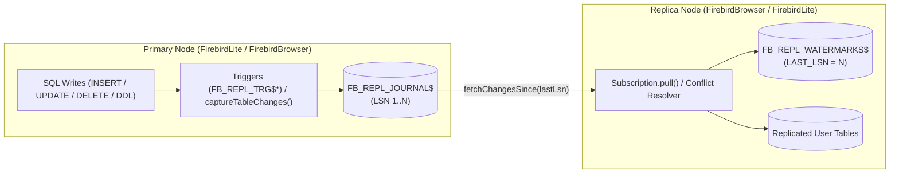
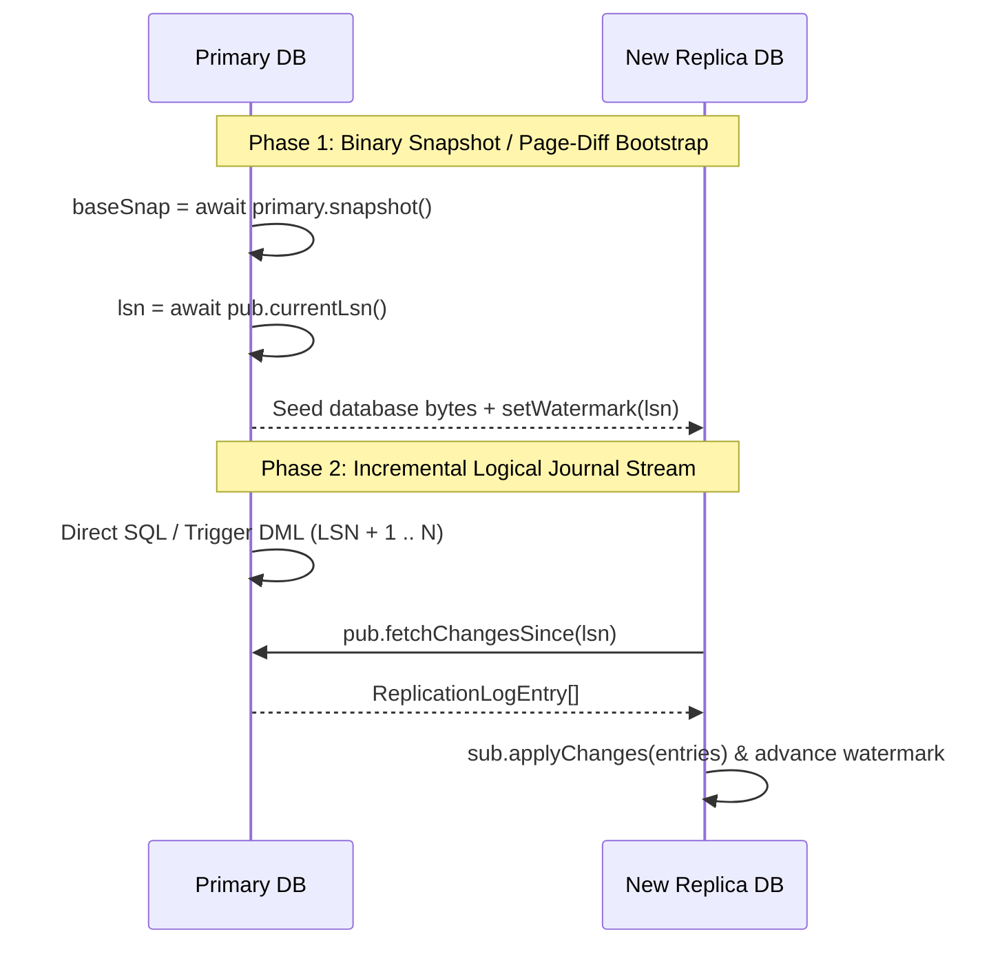

# Database Replication Guide (`firebird-wasm/replication`)

`firebird-wasm/replication` provides logical and journal-based database replication between `FirebirdLite` (Node.js / server / desktop) and `FirebirdBrowser` (WebAssembly / OPFS / IndexedDB), as well as peer-to-peer across browser tabs or edge workers.

> **Interactive Simulator & Live Demo**: Try the [Firebird WASM Replication Simulator & Live Demo](https://mariuz.github.io/electric-firebird/replication.html) (`demo/public/replication.html`) to inspect live `FB_REPL_JOURNAL$` LSN streams, trigger capture, network partitions, and 3-way conflict resolution in real time.

---

## Table of Contents

1. [Architecture Overview](#1-architecture-overview)
2. [Quick Start — Replication Setup](#2-quick-start--replication-setup)
   - [High-Level `replicateDatabases()` Setup](#21-high-level-replicatedatabases-setup)
   - [Explicit Publication & Subscription Setup](#22-explicit-publication--subscription-setup)
3. [Native Firebird SQL Trigger-Based Change Capture](#3-native-firebird-sql-trigger-based-change-capture)
   - [Automatic Trigger Installation (`installReplicationTriggers`)](#31-automatic-trigger-installation-installreplicationtriggers)
   - [Loop Prevention via `RDB$GET_CONTEXT` / `RDB$SET_CONTEXT`](#32-loop-prevention-via-rdbget_context--rdbset_context)
4. [Conflict Resolution Strategies](#4-conflict-resolution-strategies)
5. [Full Database Replication: Snapshot Bootstrap & Schema Evolution](#5-full-database-replication-snapshot-bootstrap--schema-evolution)
   - [Phase 1 — Initial Snapshot or Binary Page-Diff (`exportDiff` / `applyDiff`) Bootstrap](#51-phase-1--initial-snapshot-or-binary-page-diff-exportdiff--applydiff-bootstrap)
   - [Phase 2 — Automatic Schema Evolution (`diffSchema` + `generateMigration`)](#52-phase-2--automatic-schema-evolution-diffschema--generatemigration)
   - [Phase 3 — Journal Pruning & Watermark Management](#53-phase-3--journal-pruning--watermark-management)
6. [Replication Use Cases](#6-replication-use-cases)
7. [API Reference](#7-api-reference)

---

## 1. Architecture Overview

Replication in `firebird-wasm` is built around three core primitives stored inside standard Firebird SQL tables and sequences:

1. **Change Journal (`FB_REPL_JOURNAL$`) & Sequence (`FB_REPL_LSN_GEN$`)**:
   Every published DDL or DML mutation (`INSERT`, `UPDATE`, `DELETE`, `DDL`) is recorded with a monotonically increasing **Log Sequence Number (`LSN`)**, transaction ID (`TXID`), originating node ID (`ORIGIN`), publication name (`PUBLICATION`), primary key (`KEY_JSON`), `BEFORE_JSON` / `AFTER_JSON` row snapshots, and epoch timestamp (`TS`).
2. **Replica Watermarks (`FB_REPL_WATERMARKS$`)**:
   Each subscriber persists its last applied `LAST_LSN` watermark inside `FB_REPL_WATERMARKS$` within the same atomic replica transaction that applies the incoming changes—guaranteeing **at-least-once delivery with idempotent replay**.
3. **Echo-Loop Prevention (`ORIGIN` & `FB_REPL_ROLE`)**:
   In bidirectional (`primary <-> replica`) topologies, changes are tagged with `origin: nodeId` and applied under `RDB$SET_CONTEXT('USER_SESSION', 'FB_REPL_ROLE', 'REPLICA')` so replica replay never re-triggers local change capture.



---

## 2. Quick Start — Replication Setup

### 2.1 High-Level `replicateDatabases()` Setup

Use `replicateDatabases()` to pair two `FirebirdBrowser` or `FirebirdLite` instances in either `'one-way'` (`primary -> replica`) or `'bidirectional'` (`primary <-> replica`) mode:

```ts
import { FirebirdBrowser, replicateDatabases } from 'firebird-wasm/browser';

const primary = await FirebirdBrowser.create({ database: 'primary.fdb' });
const replica = await FirebirdBrowser.create({ database: 'replica.fdb' });

// Provision schema on both nodes
const schemaSql = `
  CREATE TABLE TODOS (
    ID INTEGER NOT NULL PRIMARY KEY,
    TITLE VARCHAR(120) NOT NULL,
    DONE SMALLINT DEFAULT 0
  )
`;
await primary.exec(schemaSql);
await replica.exec(schemaSql);

// Pair databases in bidirectional mode with 3-way field-level merge
const replicator = await replicateDatabases({
  primary,
  replica,
  tables: [{ table: 'TODOS', primaryKey: 'ID', columns: ['ID', 'TITLE', 'DONE'] }],
  direction: 'bidirectional', // 'one-way' | 'bidirectional'
  onConflict: 'merge',       // 'primary-wins' | 'replica-wins' | 'last-write-wins' | 'merge' | fn
  installTriggers: true,     // Install AFTER INSERT/UPDATE/DELETE PSQL triggers
  onConflictResolved(ctx, resolution) {
    console.log(`Conflict on ${ctx.incoming.table} resolved via ${resolution}`);
  },
});

// Mutate primary and replica independently
await primary.execute('INSERT INTO TODOS (ID, TITLE, DONE) VALUES (?, ?, ?)', [1, 'Ship WASM engine', 0]);
await replica.execute('INSERT INTO TODOS (ID, TITLE, DONE) VALUES (?, ?, ?)', [2, 'Write replication docs', 1]);

// Run a single replication cycle (or call `replicator.start()` for continuous background sync)
const stats = await replicator.sync();
console.log('Primary -> Replica:', stats.primaryToReplica);
console.log('Replica -> Primary:', stats.replicaToPrimary);
```

### 2.2 Explicit Publication & Subscription Setup

When the primary and replica live in separate processes (e.g., a Node.js `FirebirdLite` backend and a browser `FirebirdBrowser` client over HTTP/WebSocket), create the publication and subscription separately:

```ts
import { createPublication, createSubscription } from 'firebird-wasm/replication';

// 1. On the Primary (Server):
const publication = await createPublication(serverDb, {
  name: 'edge_pub',
  nodeId: 'cloud-primary-1',
  tables: [
    { table: 'PROJECTS', primaryKey: 'ID' },
    { table: 'TASKS', primaryKey: 'ID' },
  ],
  installTriggers: true,
});

// Expose an HTTP endpoint that returns `publication.fetchChangesSince(sinceLsn, { limit, excludeOrigin })`

// 2. On the Replica (Browser Client):
const subscription = await createSubscription(browserDb, {
  name: 'edge_sub_client_42',
  nodeId: 'browser-client-42',
  publication: {
    name: 'edge_pub',
    async fetchChangesSince(sinceLsn, opts) {
      const res = await fetch(
        `/api/replication/changes?sinceLsn=${sinceLsn}&limit=${opts?.limit ?? 500}&excludeOrigin=${opts?.excludeOrigin ?? ''}`,
      );
      return res.json();
    },
  },
  onConflict: 'last-write-wins',
  pollIntervalMs: 1000,
});

// Pull on demand or start background polling:
await subscription.pull();
subscription.start();
```

---

## 3. Native Firebird SQL Trigger-Based Change Capture

### 3.1 Automatic Trigger Installation (`installReplicationTriggers`)

When `installTriggers: true` is passed to `createPublication()` (or `installReplicationTriggers(db, options)` is called directly), `firebird-wasm` provisions:

1. An atomic LSN sequence: `CREATE SEQUENCE FB_REPL_LSN_GEN$`
2. The change journal table: `FB_REPL_JOURNAL$`
3. An idempotent `AFTER INSERT OR UPDATE OR DELETE POSITION 32000` PSQL trigger (`FB_REPL_TRG$<TABLE>`) on every published table, plus `POST_EVENT 'fb_repl_<publication>'` for instant event-driven wakeups.

```ts
import { installReplicationTriggers, buildReplicationTriggerDdl } from 'firebird-wasm/replication';

const triggers = await installReplicationTriggers(db, {
  publication: 'default',
  nodeId: 'primary-1',
  tables: [
    { table: 'ORDERS', primaryKey: ['ID'], columns: ['ID', 'CUSTOMER', 'TOTAL', 'STATUS'] },
  ],
});

console.log(triggers[0].triggerName); // "FB_REPL_TRG$ORDERS"
console.log(triggers[0].eventName);   // "fb_repl_default"
```

### 3.2 Loop Prevention via `RDB$GET_CONTEXT` / `RDB$SET_CONTEXT`

Every generated trigger guards execution with Firebird's session context variable `FB_REPL_ROLE`:

```sql
IF (RDB$GET_CONTEXT('USER_SESSION', 'FB_REPL_ROLE') IS DISTINCT FROM 'REPLICA') THEN
BEGIN
  -- Serialize NEW.* / OLD.* into FB_REPL_JOURNAL$ and POST_EVENT
END
```

When `subscription.pull()` or `subscription.applyChanges()` runs on a replica, it wraps the batch transaction in:

```sql
SELECT RDB$SET_CONTEXT('USER_SESSION', 'FB_REPL_ROLE', 'REPLICA') FROM RDB$DATABASE;
-- Apply incoming DDL & DML changes
SELECT RDB$SET_CONTEXT('USER_SESSION', 'FB_REPL_ROLE', 'PRIMARY') FROM RDB$DATABASE;
```

This guarantees that applying remote changes on a node that also has triggers installed never re-logs those mutations back into the local journal.

---

## 4. Conflict Resolution Strategies

When two nodes modify the same primary key concurrently before syncing, `createSubscription` / `replicateDatabases` detects the conflict by comparing `entry.before` against `localRow` (and `localEntry.timestamp`) and invokes the configured `onConflict` strategy:

| Strategy | Behavior | Best For |
|---|---|---|
| `'primary-wins'` / `'remote-wins'` | Incoming change overwrites the local row. | Read replicas, server-authoritative caches. |
| `'replica-wins'` / `'local-wins'` | Local row is preserved; conflicting remote mutation is skipped. | Local user overrides, sticky drafts. |
| `'last-write-wins'` | Compares `incoming.timestamp` vs `localEntry.timestamp` (deterministic tie-breaker on `origin` node ID). | General active-active peer sync. |
| `'merge'` | **3-way field-level merge** (`mergeReplicatedRow(before, localRow, remoteAfter)`): merges non-overlapping column edits onto the same row. | Collaborative forms, multi-column task/document editors. |
| Custom `(ctx) => ...` | Receives `{ incoming, localRow, localEntry }` and returns `'remote-wins'`, `'local-wins'`, `'merge'`, or `{ action: 'merge', row }`. | Domain-specific business rules (e.g., inventory counters, financial ledgers). |

#### Example: Custom Conflict Resolver

```ts
const sub = await createSubscription(replicaDb, {
  publication,
  onConflict: ({ incoming, localRow }) => {
    if (incoming.table === 'INVENTORY' && localRow && incoming.after && incoming.before) {
      // Additive delta merge on QTY column
      const delta = Number(incoming.after.QTY) - Number(incoming.before.QTY);
      return {
        action: 'merge',
        row: {
          ...localRow,
          ...incoming.after,
          QTY: Number(localRow.QTY) + delta,
        },
      };
    }
    return 'merge';
  },
});
```

---

## 5. Full Database Replication: Snapshot Bootstrap & Schema Evolution

For large databases or newly provisioned replicas, replaying the entire historical `FB_REPL_JOURNAL$` from `LSN = 0` is unnecessary. Combine **Incremental Binary Page Diffs (`exportDiff` / `applyDiff`)** with **Logical Journal Replay** for fast full-database replication:



### 5.1 Phase 1 — Initial Snapshot or Binary Page-Diff (`bootstrapReplica` & `exportSnapshot`)

Use `bootstrapReplica()` (or enable `autoBootstrap: true` on `createSubscription()` / `replicateDatabases()`) to automatically seed a brand-new replica or catch up a replica whose watermark has fallen behind a pruned journal (`watermark < minRetainedLsn`):

```ts
import { bootstrapReplica, needsBootstrap } from 'firebird-wasm/replication';

// Check if the replica needs bootstrapping (e.g. watermark === 0 or behind minRetainedLsn)
const check = await needsBootstrap(primaryPublication, replicaSubscription);
if (check.needed) {
  const boot = await bootstrapReplica({
    targetDb: replica,
    publication: primaryPublication,
    subscription: replicaSubscription,
    mode: 'logical', // or 'page-diff' for binary FBDF\x01 page diff
  });
  console.log(`Bootstrapped ${boot.rowsCopied} rows at LSN ${boot.watermarkLsn}`);
}
```

### 5.2 Phase 2 — Whole-Database Publication (`publishAllTables`) & Catalog Sync (`syncCatalog`)

Publish every user table (`tables: '*'`) and keep replica schemas + Firebird sequence/generator watermarks (`RDB$GENERATORS`) synchronized via `syncCatalog()`:

```ts
import { publishAllTables, syncCatalog } from 'firebird-wasm/replication';

// Publish all user tables (excluding scratch/audit tables)
const pub = await publishAllTables(primary, {
  name: 'full_pub',
  excludeTables: ['AUDIT_SCRATCH'],
  installTriggers: true,
});

// Synchronize schema DDL (via diffSchema + generateMigration) and sequence watermarks:
const catResult = await syncCatalog({
  sourceDb: primary,
  targetDb: replica,
  excludeTables: ['AUDIT_SCRATCH'],
});
console.log(catResult.discoveredTables, catResult.sequencesSynced);
```

### 5.3 Phase 3 — Multi-Tenant Row/Column Filtering & Topological Foreign-Key Replay

Slice publications per tenant with `where` predicates and `columns` / `excludeColumns` projections, and declare foreign-key `references` so multi-table transactions (`txid`) replay parents before children on `INSERT`/`UPDATE` and children before parents on `DELETE`:

```ts
const tenantPub = await createPublication(primary, {
  name: 'tenant_acme_pub',
  tables: [
    {
      table: 'USERS',
      primaryKey: 'ID',
      excludeColumns: ['PASSWORD_HASH'],
      where: "TENANT_ID = 'acme'",
    },
    {
      table: 'ORDERS',
      primaryKey: 'ID',
      where: "TENANT_ID = 'acme'",
      references: ['USERS'],
    },
  ],
});
```

### 5.4 Phase 4 — Hybrid Logical Clocks (`createHlc`) & Per-Column CRDTs (`createCrdtConflictResolver`)

Use `createHlc()` for skew-tolerant causal ordering (`<wallMs>:<counter>:<nodeId>`) and `createCrdtConflictResolver()` to combine per-column CRDT strategies (`'pn-counter'`, `'set-union'`, `'g-set'`, `'max'`, `'min'`, `'lww'`):

```ts
import { replicateDatabases, createCrdtConflictResolver } from 'firebird-wasm/replication';

const replicator = await replicateDatabases({
  primary: nodeA,
  replica: nodeB,
  tables: [{ table: 'PRODUCTS', primaryKey: 'ID' }],
  direction: 'bidirectional',
  onConflict: createCrdtConflictResolver({
    columns: {
      STOCK: 'pn-counter', // additive delta merge: base + localDelta + remoteDelta
      TAGS: 'set-union',   // 2P/OR-Set union with removal tracking
      HIGH_BID: 'max',     // join-semilattice max
      TITLE: 'lww',        // HLC-ordered Last-Write-Wins
    },
  }),
});
```

### 5.5 Phase 5 — Replication Slots (`FB_REPL_SLOTS$`) & Safe Auto-Pruning (`pruneAcked`)

Each subscriber registers a slot in `FB_REPL_SLOTS$` (`slotName`, `nodeId`, `confirmedFlushLsn`, `lastSeenAt`, `ttlMs`). Calling `publication.pruneAcked()` expires stale slots past their TTL and safely deletes only journal entries `<= MIN(confirmedFlushLsn)` across all active subscribers:

```ts
// Automatically expire stale slots and prune journal entries acknowledged by all active replicas:
const pruneResult = await primaryPublication.pruneAcked();
console.log(pruneResult);
// { expiredSlots: [], activeSlotCount: 2, safeLsn: 42, prunedEntries: 42 }
```

### 5.6 Phase 6 — Network Transports (HTTP/SSE, WebSocket & `BroadcastChannel`)

Connect `FirebirdLite` (server) and `FirebirdBrowser` (WASM) across HTTP/SSE, duplex WebSockets, or browser tabs:

```ts
import {
  createHttpReplicationHandler,
  createHttpReplicationClient,
  createBroadcastChannelTransport,
  createWebSocketReplicationPeer,
  createSubscription,
} from 'firebird-wasm/replication';

// 1. Server HTTP/SSE endpoint (Web Fetch API Request -> Response)
const handler = createHttpReplicationHandler({
  publication: primaryPublication,
  apiKey: process.env.REPL_SECRET,
});

// 2. Browser HTTP client + subscription
const client = createHttpReplicationClient({
  baseUrl: 'https://api.example.com/replication',
  name: 'pub_primary',
  apiKey: '...',
});
const browserSub = await createSubscription(browserDb, {
  name: 'browser_sub',
  publication: client,
});

// 3. Cross-tab BroadcastChannel sync
const tabTransport = createBroadcastChannelTransport({
  channelName: 'app_repl_bus',
  publication: localPub,
  subscription: browserSub,
});
```

### 5.7 Phase 7 — Firebird 4.0/5.0 Native Binary Journal Segments, Index Hooks & `replicator.stats()`

Encode/decode binary journal segments (`0x52444246` `'FBDR'` header + FNV-1a checksum), keep local `HnswIndex` / `Bm25Index` search indexes updated incrementally via `indexHooks`, and monitor live replication lag via `replicator.stats()`:

```ts
import {
  encodeNativeJournalSegment,
  decodeNativeJournalSegment,
} from 'firebird-wasm/replication';

// Live lag & throughput telemetry:
const telemetry = await replicator.stats();
console.log(telemetry.lagEntries, telemetry.lagMs, telemetry.bytesTransferred);

// Binary journal segment round-trip:
const entries = await primaryPublication.fetchChangesSince(0);
const segmentBytes = encodeNativeJournalSegment(entries, {
  guid: 'a1b2c3d4-e5f6-4789-8012-3456789abcde',
  sequence: 1,
  state: 'archivable',
});
const decoded = decodeNativeJournalSegment(segmentBytes);
```

### 5.8 Phase 8 — Automatic Failover & Replica-to-Primary Promotion (`promoteReplica`)

Promote a standby replica to the new primary in a single call — draining pending changes, validating replication lag against `maxAllowedLagEntries`, bumping sequence watermarks (`sequenceBuffer`), resetting `FB_REPL_ROLE` to `'PRIMARY'`, installing triggers, and re-seeding peer subscriptions:

```ts
import { promoteReplica } from 'firebird-wasm/replication';

const promoted = await promoteReplica({
  replicaDb: replica1,
  subscription: sub1,
  previousPrimaryDb: oldPrimary, // optional if reachable
  maxAllowedLagEntries: 0,
  sequenceBuffer: 100,
  promotedNodeId: 'primary-2',
  installTriggers: true,
  peerSubscriptions: [sub2],
});
console.log(promoted.promotedNodeId, promoted.publishedTables);
```

### 5.9 Phase 9 — Encrypted & Gzip-Compressed Journal Segments (AES-256-GCM)

Compress journal segments with Gzip (`CompressionStream('gzip')`) and encrypt them end-to-end with WebCrypto AES-256-GCM (`0x53444246` `'FBDS'` envelope) using a 32-byte key, `CryptoKey`, or PBKDF2 passphrase:

```ts
import {
  encodeEncryptedJournalSegment,
  decodeEncryptedJournalSegment,
} from 'firebird-wasm/replication';

const encryptedWireBytes = await encodeEncryptedJournalSegment(entries, {
  key: 'cluster-replication-passphrase',
  compress: true,
  aad: 'prod-eu-west',
});

const { segment, compressed, encrypted } = await decodeEncryptedJournalSegment(
  encryptedWireBytes,
  { key: 'cluster-replication-passphrase', aad: 'prod-eu-west' },
);
```

### 5.10 Phase 10 — Time-Travel Querying (`asOfLsn`) & Point-in-Time Rollback (`rewindToLsn`)

Reconstruct historical table state at any past LSN, timestamp, or HLC without mutating the live database via `asOfLsn()`, or roll back the live database in reverse chronological order via `rewindToLsn()`:

```ts
import { asOfLsn, rewindToLsn } from 'firebird-wasm/replication';

// 1. Non-destructive point-in-time snapshot at LSN 42 (or { timestamp } / { hlc }):
const historical = await asOfLsn(db, 42);
console.log(historical.tables.ACCOUNTS);

// 2. Roll back the live database to LSN 42 using BEFORE_JSON / AFTER_JSON inverse DML:
const rewindResult = await rewindToLsn(db, 42);
console.log(`Undid ${rewindResult.entriesUndone} operations back to LSN ${rewindResult.rewoundToLsn}`);
```

---

## 6. Replication Use Cases

| # | Use Case | Topology | Recommended Conflict Strategy |
|---|---|---|---|
| **1** | **Offline-First Field & Mobile Apps** | Bidirectional (`FirebirdBrowser` ↔ `FirebirdLite`) | `'merge'` (3-way field merge) |
| **2** | **Multi-Tab / Multi-Window Instant Sync** | Bidirectional across tabs (`BroadcastChannel` + OPFS) | `'last-write-wins'` |
| **3** | **Cloud-to-Browser Read Replicas** | One-Way (`FirebirdLite` → `FirebirdBrowser`) | `'primary-wins'` |
| **4** | **Edge / CDN Read Scaling** | One-Way Fan-Out (1 Primary → N Edge Workers) | `'primary-wins'` |
| **5** | **Collaborative Multi-User Workspaces** | Bidirectional Hub-and-Spoke | `'merge'` + custom resolvers |
| **6** | **Zero-Downtime Schema & Version Upgrades** | Shadow Replica (`diffSchema` + `replicateDatabases`) | `'primary-wins'` |
| **7** | **Continuous Backup, PITR & Audit Time-Travel** | Append-Only Journal Subscriber (`FB_REPL_JOURNAL$`) | `'primary-wins'` |
| **8** | **Hybrid RAG / Local Vector + BM25 Search Sync** | One-Way (`primary` → local `HnswIndex` / `Bm25Index`) | `'primary-wins'` |
| **9** | **Multi-Tenant Data Slicing (Partial Publications)** | Filtered Per-Tenant Publication → Client Replica | `'primary-wins'` / `'merge'` |
| **10** | **CI / Ephemeral PR Preview Databases** | Snapshot `exportDiff` + Journal Tail | `'primary-wins'` |
| **11** | **Desktop Electron / Tauri Local-to-Cloud Sync** | Bidirectional (`FirebirdLite` Desktop ↔ Cloud) | `'merge'` / `'last-write-wins'` |
| **12** | **Telemetry & IoT Edge-to-Central Consolidation** | Many-to-One (`Edge Replicas` → `Central Aggregator`) | `'replica-wins'` / append-only |

---

## 7. API Reference

| Export | Description |
|---|---|
| `replicateDatabases(options)` | High-level helper pairing `primary` and `replica` in `'one-way'` or `'bidirectional'` mode. |
| `createPublication(db, options)` | Provisions `FB_REPL_JOURNAL$` and returns a `ReplicationPublication` handle. |
| `createSubscription(db, options)` | Provisions `FB_REPL_WATERMARKS$` and returns a `ReplicationSubscription` handle. |
| `installReplicationTriggers(db, options)` | Creates `FB_REPL_LSN_GEN$` and installs `AFTER INSERT OR UPDATE OR DELETE` PSQL triggers on published tables. |
| `dropReplicationTriggers(db, options)` | Drops replication triggers for the given tables and publication. |
| `buildReplicationTriggerDdl(options)` | Pure helper returning `{ triggerName, eventName, ddl }` for a table's PSQL replication trigger. |
| `replicationTriggerName(table, pub?)` | Deterministic ≤31-char Firebird trigger name (`FB_REPL_TRG$<TABLE>`). |
| `replicationEventName(pub?)` | Deterministic ≤31-char Firebird `POST_EVENT` name (`fb_repl_<pub>`). |
| `mergeReplicatedRow(before, local, remote)` | 3-way field-level merge helper used by the `'merge'` conflict strategy. |
| `bootstrapReplica(options)` | Seeds or re-seeds a replica from a logical or binary page-diff `PublicationSnapshot`. |
| `needsBootstrap(pub, sub)` | Checks whether a replica is uninitialized or behind `pub.minRetainedLsn()`. |
| `publishAllTables(db, options?)` | Whole-database publication (`tables: '*'`) discovering all user tables via `discoverUserTables()`. |
| `syncCatalog(options)` | Synchronizes schema DDL (`generateMigration`) and generator/sequence watermarks (`exportSequences` + `applySequences`). |
| `projectReplicatedRow(row, pk, cols?, excl?)` | Projects a row according to `columns` whitelist and `excludeColumns` blacklist. |
| `matchesRowFilter(row, where?)` | Evaluates a SQL `WHERE` predicate string or filter function against a row. |
| `orderEntriesByTopology(entries, deps?)` | Groups journal entries by `txid` and orders parent/child tables topologically. |
| `createHlc(nodeId, options?)` | Creates a monotonic Hybrid Logical Clock (`<wallMs>:<counter>:<nodeId>`). |
| `mergeCrdtRow(ctx, config?)` | Per-column CRDT conflict merger (`'lww'`, `'pn-counter'`, `'set-union'`, `'g-set'`, `'max'`, `'min'`). |
| `createCrdtConflictResolver(config?)` | Returns a pluggable `onConflict` resolver callback backed by `mergeCrdtRow()`. |
| `createHttpReplicationHandler(options)` | Web Fetch API `(Request) => Promise<Response>` handler serving `/changes`, `/ack`, `/heartbeat`, `/snapshot`, `/push`, and `/events` (SSE). |
| `createHttpReplicationClient(options)` | Remote HTTP replication client compatible with `createSubscription()`. |
| `createBroadcastChannelTransport(options?)` | Cross-tab / cross-worker replication transport backed by `BroadcastChannel`. |
| `createWebSocketReplicationPeer(options)` | Duplex WebSocket replication peer streaming entries, pull requests, and slot acks. |
| `encodeNativeJournalSegment(entries, opts?)` | Encodes journal entries into a Firebird 4.0/5.0 binary journal segment (`0x52444246`). |
| `decodeNativeJournalSegment(bytes)` | Validates FNV-1a checksum and decodes a Firebird 4.0/5.0 binary journal segment. |
| `promoteReplica(options)` | Drains lag, syncs sequence watermarks, resets `FB_REPL_ROLE='PRIMARY'`, installs triggers, and promotes a replica to primary. |
| `encodeEncryptedJournalSegment(entries, opts?)` | Gzip-compresses and encrypts a journal segment with WebCrypto AES-256-GCM (`0x53444246`). |
| `decodeEncryptedJournalSegment(bytes, opts?)` | Decrypts and decompresses an encrypted journal segment (or transparently decodes raw `0x52444246` segments). |
| `asOfLsn(db, target)` | Non-destructively reconstructs historical table rows at any past LSN, timestamp, or HLC. |
| `rewindToLsn(db, targetOrOptions)` | Rolls back a live database to a historical LSN, timestamp, or HLC using inverse DML from `BEFORE_JSON`. |
| `createReplicationMesh(options)` | Coordinates $N \ge 2$ database nodes in `'mesh'` or `'hub-and-spoke'` topologies with transitive routing, `watermarkMatrix()`, and `pruneQuorum()`. |
| `createReplicationHub(options)` | Convenience wrapper creating a `'hub-and-spoke'` replication coordinator (`1` hub ↔ $N$ spokes). |
| `createReplicationDlq(db, options?)` | Provisions `FB_REPL_DLQ$` for quarantining, inspecting, retrying, and discarding poison journal entries. |
| `createPiiMaskingTransformer(rules, options?)` | Creates a declarative PII redaction / row transformation callback (`'email-mask'`, `'card-last4'`, `'hash-sha256'`, `'redact'`, etc.) for `transformRow`. |
| `exportJournalArchive(pub, options?)` | Packages a base snapshot + chunked encrypted/compressed `0x53444246` journal segments into a portable PITR bundle. |
| `applyJournalArchive(db, archive, options?)` | Restores a database from a `ReplicationJournalArchive` up to an optional target LSN, timestamp, or HLC. |

---

## 16. Multi-Node Mesh & Hub-and-Spoke Replication (`createReplicationMesh` / `createReplicationHub`)

Coordinate $N \ge 2$ database nodes in either `'hub-and-spoke'` (1 central hub ↔ $N$ edge/browser spokes with automatic transitive origin forwarding) or full `'mesh'` ($N \times (N-1)$ peer links) topologies:

```ts
import { createReplicationHub, createCrdtConflictResolver } from 'firebird-wasm/replication';

const hub = await createReplicationHub({
  hubNodeId: 'cloud-hub',
  nodes: [
    { nodeId: 'cloud-hub', db: hubDb },
    { nodeId: 'edge-eu', db: spokeEuDb },
    { nodeId: 'edge-us', db: spokeUsDb },
  ],
  tables: [{ table: 'TASKS', primaryKey: 'ID' }],
  onConflict: createCrdtConflictResolver({ columns: { STOCK: 'pn-counter' } }),
});

// Converges spoke-eu -> cloud-hub -> spoke-us and spoke-us -> cloud-hub -> spoke-eu
await hub.sync();

// Inspect watermarks[subscriberNodeId][publisherNodeId] and prune quorum-acknowledged entries
const matrix = await hub.watermarkMatrix();
const prunedByNode = await hub.pruneQuorum();
```

---

## 17. Dead-Letter Queue (`FB_REPL_DLQ$`) & Quarantine / Retry Policy

Configure `onApplyError: 'dlq'` (or a custom policy callback) and optional `validateEntry` on `createSubscription()` so a single poison row never stalls the replication stream:

```ts
import { createSubscription } from 'firebird-wasm/replication';

const sub = await createSubscription(replicaDb, {
  name: 'sub_orders',
  nodeId: 'replica-1',
  publication: primaryPub,
  onApplyError: 'dlq',
  validateEntry(entry) {
    if (entry.after && Number(entry.after.TOTAL ?? 0) < 0) {
      throw new Error('CHECK constraint violation: TOTAL must be non-negative');
    }
  },
});

await sub.pull();
const quarantined = await sub.listDlq!();

// Sanitize and re-apply quarantined entries from FB_REPL_DLQ$
await sub.retryDlq!({
  transformEntry: (e) => ({
    ...e,
    after: { ...e.after, TOTAL: Math.abs(Number(e.after?.TOTAL ?? 0)) },
  }),
});
```

---

## 18. Data Masking, PII Redaction & Row Transformation Pipelines (`transformRow`)

Attach `transformRow` (or `createPiiMaskingTransformer`) to a publication or subscription to redact sensitive columns before changes leave a primary or land on an analytics/browser replica:

```ts
import { createPublication, createPiiMaskingTransformer } from 'firebird-wasm/replication';

const pub = await createPublication(primaryDb, {
  name: 'pub_customers',
  nodeId: 'prod-primary',
  tables: [{ table: 'CUSTOMERS', primaryKey: 'ID' }],
  transformRow: createPiiMaskingTransformer(
    {
      EMAIL: 'email-mask',       // 'jane.doe@example.com' -> 'j***e@example.com'
      CARD_NUMBER: 'card-last4', // '4111-2222-3333-4444'  -> '************4444'
      SSN: 'redact',             // '[REDACTED]'
      PHONE: 'hash-sha256',      // salted SHA-256 hex digest
      SECRET_TOKEN: 'null',      // null
    },
    { salt: 'prod-tenant-salt' },
  ),
});
```

---

## 19. Journal Archival & Point-in-Time Recovery (PITR) Bundles (`exportJournalArchive` / `applyJournalArchive`)

Export a publication's journal stream (and optional `baseSnapshot`) into a multi-segment Gzip + AES-256-GCM encrypted PITR archive, and restore any database up to a target LSN, timestamp, or HLC:

```ts
import { exportJournalArchive, applyJournalArchive } from 'firebird-wasm/replication';

const archive = await exportJournalArchive(primaryPub, {
  maxEntriesPerSegment: 100,
  compress: true,
  key: 'pitr-backup-passphrase',
  aad: 'cluster-prod',
});

// Restore a fresh database stopping at historical LSN 42
const result = await applyJournalArchive(recoveryDb, archive, {
  key: 'pitr-backup-passphrase',
  aad: 'cluster-prod',
  target: { lsn: 42 },
});
```
